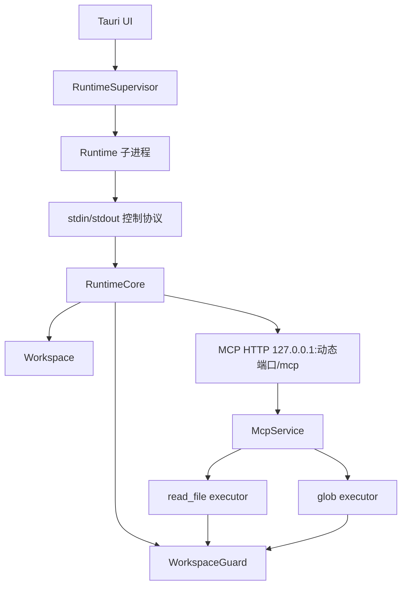

# ChatGPT-Harness 全仓库只读审计报告

## 1. 执行摘要

**审计结论先行：**

1. **当前 M5（Read-Only MCP Runtime，纯只读 MCP 运行时）代码已基本形成真实执行链，但本次不能判定为完整验收通过。**  
   建议状态：**PARTIAL / NOT VERIFIED（部分满足 / 未充分验证）**。

2. **M5 的核心代码不是纯接口或 Mock：**
    - UI 能启动真实 Runtime 子进程；
    - Runtime 能初始化工作区；
    - Runtime 能启动回环 Streamable HTTP MCP endpoint；
    - MCP 能暴露 `read_file` 与 `glob`；
    - 两个工具都经过 `WorkspaceGuard`；
    - Runtime 能处理 initialized acknowledgement、stop、EOF 和 MCP 服务关闭。

3. **但架构中存在一个重要文档冲突：**
    - `ARCHITECTURE.md` 将 Policy Engine（策略引擎）列为所有可执行请求的强制安全链路；
    - Roadmap 将完整 Policy / State Machine / Audit 安排在 M6；
    - 当前 `McpService::call_tool()` 直接进入工具执行器，没有 Policy Engine、Request Envelope 或工具调用审计事件。

4. **本次没有运行测试、构建、lint、类型检查或 MCP 动态验证。**  
   因此不能将测试文件、提交信息、验收文档或测试代码本身视为已通过的验证证据。

5. **当前不具备发布或真实使用安全就绪条件。**  
   判断：**NO-GO（不适合发布）**。主要原因是 M6 Policy/Audit、M7 tunnel-client 集成、M8 Developer/Test Mode、M9 Hardening & Release 尚未形成完整可验证闭环，且当前 M5 也缺少动态验收证据。

6. **进入 M6 可以考虑 GO WITH CONDITIONS（有条件进入）**，但前提是：
    - 不把 M5 当前实现宣称为最终安全执行链；
    - 明确解决“Policy 是 M5 当前强制边界还是 M6 延后交付”的文档冲突；
    - 先补齐 M5 的动态验收证据；
    - M6 的实现必须接入现有 MCP 工具真实调用链，而不是仅提供 UI 或协议占位接口。

---

## 2. 审计快照

| 项目 | 结果 |
|---|---|
| 审计日期 | 2026-09-07 |
| 仓库 | `D:\ChatGPT-Harness` |
| 分支 | `main` |
| HEAD | `7611cb10337984a510f70501eb29a43d66f28c86` |
| 审计对象 | 当前工作树，重点对照 HEAD 与当前未提交状态 |
| 审计模式 | 静态只读审计 |
| 测试/构建/lint | 本次未执行 |
| 动态 MCP E2E | 本次未执行 |
| `CONTEXT.md` | 缺失 |
| 工作树状态 | 存在未提交修改：`docs-ai/feature/feat5-M5-Read-Only MCP Runtime/Repository Audit.md` |
| 生成物 | `target/` 存在，未逐文件审查 |
| 二进制 | 仓库包含 `tunnel-client-v0.0.13-windows-amd64/`，仅审查其存在和周边集成，未反编译或推断二进制内部行为 |

本次没有修改、创建、删除或格式化仓库文件。

---

## 3. 审计范围与覆盖情况

| 模块 | 关键文件 | 审查深度 | 结论 |
|---|---|---|---|
| 产品边界 | `docs-ai/PRODUCT.md` | 规范级 | 已确认 V1 分工与排除项 |
| 架构约束 | `docs-ai/ARCHITECTURE.md` | 规范级 | 已确认执行管线、Workspace、Policy、生命周期要求 |
| Roadmap | `docs-ai/Roadmap.md` | 里程碑级 | 已确认 M0-M9 目标与顺序 |
| MCP Service | `runtime/src/mcp/service.rs` | 入口和真实调用链 | 已接入 `read_file`、`glob` |
| MCP HTTP | `runtime/src/mcp/http.rs` | endpoint、监听、关闭 | 静态设计合理，未动态验证 |
| MCP Runtime 生命周期 | `runtime/src/mcp/runtime.rs`、`runtime/src/state.rs`、`runtime/src/server.rs` | 初始化、ack、stop、EOF、join | 真实连接存在，未动态验证 |
| 工具注册 | `runtime/src/tools/registry.rs` | Catalog 与暴露能力 | Normal Mode 仅暴露两个只读工具 |
| 文件读取 | `runtime/src/tools/read_file.rs`、`runtime/src/mcp/read_file.rs` | 参数、边界、输出限制 | 有真实执行器和限制 |
| Glob | `runtime/src/tools/glob.rs`、`runtime/src/mcp/glob.rs` | 模式限制、遍历、边界 | 有逐候选路径 guard |
| WorkspaceGuard | `runtime/src/workspace/guard.rs`、`path_resolver.rs`、`workspace.rs` | canonicalize、路径类型、symlink/junction 测试代码 | 静态保护较完整，TOCTOU 未验证 |
| 错误脱敏 | `runtime/src/mcp/errors.rs` | MCP 错误分类和输出 | 对外错误使用稳定类别，需继续补充动态检查 |
| 控制协议 | `protocol/src/v1/*`、`protocol/tests/contracts.rs` | 类型、方法、fixture | 协议契约存在，未执行契约测试 |
| UI Supervisor | `ui/src-tauri/src/runtime/mod.rs` | 进程启动、停止、崩溃、身份 | 真实 Runtime 控制链存在 |
| UI Commands | `ui/src-tauri/src/commands/mod.rs` | 配置、Runtime、Policy、Approval、Diagnostics | Runtime 调用真实；Policy/Approval 部分为占位/空状态 |
| UI Client | `ui/src/services/harness/local-client.ts` | Tauri 调用与状态映射 | 默认使用本地 Tauri；非 Tauri 环境有 Mock fallback |
| Mock 路径 | `ui/src/services/harness/factory.ts` | URL 参数切换 | 明确存在开发/演示 Mock 入口 |
| 配置/秘密 | `ui/src-tauri/src/config/mod.rs`、`secrets/mod.rs` | 存储与 API key 引用 | API key 进入 OS Credential Store，不写入 Config |
| tunnel-client | `ui/src-tauri/src/platform/mod.rs`、仓库二进制 | discovery 和配置 | 未发现实际启动编排 |
| 发布配置 | `ui/src-tauri/tauri.conf.json` | bundle 配置 | 当前 bundle 未启用，不能视为发布就绪 |

未逐行审查生成物、依赖缓存、第三方二进制和所有测试实现细节。

---

## 4. 产品边界与规范依据

产品文档明确：

- ChatGPT 负责 Agent Loop（智能体循环）；
- Harness 负责受控本地执行；
- Normal Mode 仅允许 `read_file` 与 `glob`；
- 自主 Agent、Memory、SubAgents、通用 shell、容器/虚拟机级沙箱等不属于当前 V1 必需范围。

依据：

- `D:\ChatGPT-Harness\docs-ai\PRODUCT.md:7-20`
- `D:\ChatGPT-Harness\docs-ai\PRODUCT.md:35-58`
- `D:\ChatGPT-Harness\docs-ai\PRODUCT.md:75-86`
- `D:\ChatGPT-Harness\docs-ai\Roadmap.md:365-367`

因此，本审计**没有因为仓库当前缺少自主 Agent、Memory、通用插件框架或 OS 级沙箱而判定为缺陷**。

---

## 5. Roadmap 与 Architecture Phase 映射

| Roadmap | 正式目标 | Architecture Phase 近似映射 |
|---|---|---|
| M0 | UI ↔ Runtime 通信协议 | Phase 1 Skeleton |
| M1 | Tauri UI Skeleton | Phase 1 |
| M2 | UI 配置与生命周期体验 | Phase 1 / 控制面基础 |
| M3 | Rust Runtime Skeleton | Phase 1 |
| M4 | Workspace Security Boundary | Phase 2 Read-Only Runtime 的前置安全基础 |
| M5 | Read-Only MCP Runtime | Phase 2 Read-Only Runtime |
| M6 | Policy / State Machine / Audit | Phase 3 Control Plane |
| M7 | tunnel-client Integration | Phase 4 Tunnel Integration |
| M8 | Developer/Test Mode | Phase 5 Developer/Test Mode |
| M9 | Hardening & Release | Phase 6 Hardening |

不能将 Roadmap 的 M5 直接理解为已经完成 Architecture 中全部安全执行链，因为两个文档在 Policy 时序上存在冲突。

---

## 6. 实际架构与调用链

### 6.1 成功调用链



### 6.2 具体证据

- UI `runtime_start` 读取配置并调用 `RuntimeSupervisor::start()`：

  `D:\ChatGPT-Harness\ui\src-tauri\src\commands\mod.rs:218-229`

- Runtime Supervisor 启动子进程，并进行 initialize、initialized、status 流程：

  `D:\ChatGPT-Harness\ui\src-tauri\src\runtime\mod.rs:497-536`

- Runtime initialize 创建 Workspace、WorkspaceGuard 和 EventBus：

  `D:\ChatGPT-Harness\runtime\src\state.rs:37-64`

- initialized notification 触发 acknowledge，进入 Ready：

  `D:\ChatGPT-Harness\runtime\src\server.rs:122-136`

- MCP endpoint 在 initialize 后启动：

  `D:\ChatGPT-Harness\runtime\src\server.rs:195-217`

- endpoint 绑定回环地址和动态端口：

  `D:\ChatGPT-Harness\runtime\src\mcp\http.rs:105-121`

- MCP 服务实际暴露两个工具：

  `D:\ChatGPT-Harness\runtime\src\mcp\service.rs:27-35`

- MCP 调用实际进入工具执行器：

  `D:\ChatGPT-Harness\runtime\src\mcp\service.rs:37-47`

- `read_file` 执行前调用 WorkspaceGuard：

  `D:\ChatGPT-Harness\runtime\src\tools\read_file.rs:110-122`

- `glob` 对 base path 和每个候选路径调用 WorkspaceGuard：

  `D:\ChatGPT-Harness\runtime\src\tools\glob.rs:115-120`  
  `D:\ChatGPT-Harness\runtime\src\tools\glob.rs:192-203`

### 6.3 关闭链路

- Runtime stop 将 readiness 置为 false，进入 Stopping 并发布 RuntimeStopped：

  `D:\ChatGPT-Harness\runtime\src\state.rs:158-169`

- Runtime server 关闭 MCP service 后返回 stop accepted：

  `D:\ChatGPT-Harness\runtime\src\server.rs:240-261`

- `McpRuntimeService::shutdown()` 发送 shutdown signal 并 join 专用线程：

  `D:\ChatGPT-Harness\runtime\src\mcp\runtime.rs:152-188`

- stdin EOF 会触发 runtime services shutdown：

  `D:\ChatGPT-Harness\runtime\src\server.rs:35-97`

静态上关闭路径存在，但本次未动态验证端口释放、后台线程终止、EOF 后服务不可达等行为。

---

# 7. 里程碑验收矩阵

## 7.1 M0-M4

| 里程碑 | 实现证据 | 验证证据 | 审计判断 |
|---|---|---|---|
| M0 | `protocol/src/v1/*`、JSON Schema、TypeScript 生成类型、IPC 代码存在 | 本次未执行协议契约测试 | **PARTIAL / NOT VERIFIED** |
| M1 | Tauri UI、页面、路由、状态组件存在 | UI 测试未执行 | **PARTIAL / NOT VERIFIED** |
| M2 | ConfigStore、SecretStore、Runtime Supervisor、配置命令存在 | 未执行 UI/Rust 测试 | **PARTIAL / NOT VERIFIED** |
| M3 | RuntimeCore、控制 server、initialize/status/stop 存在 | 未执行运行时测试 | **PARTIAL / NOT VERIFIED** |
| M4 | WorkspaceGuard、canonicalize、路径类型检查、工具边界存在 | symlink/junction 测试未执行 | **PARTIAL / NOT VERIFIED** |

## 7.2 M5

| M5 要求 | 代码证据 | 验证状态 | 判断 |
|---|---|---|---|
| Normal Mode 只暴露 `read_file`、`glob` | `runtime/src/tools/registry.rs:11-53` | 静态确认 | PASS（静态范围内） |
| MCP service 工具列表与实现一致 | `runtime/src/mcp/service.rs:32-58` | 静态确认 | PASS（静态范围内） |
| 真实 MCP call path | `runtime/src/mcp/service.rs:82-99` | 静态确认 | PASS |
| read_file 真实读取 | `runtime/src/tools/read_file.rs:114-200` | 单元测试未执行 | PARTIAL |
| glob 真实遍历 | `runtime/src/tools/glob.rs:115-212` | 单元测试未执行 | PARTIAL |
| WorkspaceGuard 边界 | `runtime/src/workspace/guard.rs`、`path_resolver.rs` | 动态 symlink/junction 未执行 | PARTIAL |
| Loopback Streamable HTTP | `runtime/src/mcp/http.rs:105-140` | HTTP E2E 未执行 | PARTIAL / NOT VERIFIED |
| initialized 后才允许工具执行 | `runtime/src/mcp/read_file.rs:22-27`、`glob.rs:21-27` | 未动态验证 | PARTIAL |
| shutdown 与 port release | `runtime/src/mcp/runtime.rs:152-188` | 测试未执行 | NOT VERIFIED |
| 错误脱敏 | `runtime/src/mcp/errors.rs` | 静态看有稳定错误类别 | PARTIAL |
| Policy Engine 已接入 | 未发现统一调用 | 静态确认缺失 | 与 Architecture 存在冲突 |
| 工具调用审计事件 | 未发现 MCP tool call audit pipeline | 静态确认缺失 | DEFERRED / M6 |
| 完整验收 | M5 Review 文档存在 | 本次未执行验收命令 | **PARTIAL / NOT VERIFIED** |

**M5 总体判断：PARTIAL / NOT VERIFIED。**

## 7.3 M6-M9

| 里程碑 | 静态证据 | 判断 |
|---|---|---|
| M6 Policy / State Machine / Audit | Runtime 有生命周期 Phase，但未发现真实 Policy Engine、审批队列、工具调用 audit 链；`policies.list` 等接口存在但不能证明安全执行链完成 | **NOT COMPLETE / DEFERRED** |
| M7 tunnel-client | 有 tunnel-client 路径规范化、发现和仓库二进制，但未发现实际进程管理、启动、健康检查、关闭编排 | **NOT COMPLETE** |
| M8 Developer/Test Mode | 未发现 bash executor；`approvals.resolve` 仍是未实现方向；不能证明 Developer/Test Mode 完整接通 | **NOT COMPLETE** |
| M9 Hardening & Release | 未完成发布配置、清洁机器验证、安全回归和打包证据；`tauri.conf.json` 中 `bundle.active` 为 false | **NOT COMPLETE** |

---

# 8. 主要发现

## P1：MCP 工具调用未经过统一 Policy Engine

### 性质

**文档冲突 + 当前安全执行链缺口**。

### 规范依据

Architecture 要求所有可执行工具请求经过统一执行管线及 Policy Engine：

- `D:\ChatGPT-Harness\docs-ai\ARCHITECTURE.md:71-84`
- `D:\ChatGPT-Harness\docs-ai\ARCHITECTURE.md:180-206`
- `D:\ChatGPT-Harness\docs-ai\ARCHITECTURE.md:434-481`

但 Roadmap 将 Policy / State Machine / Audit 安排在 M6：

- `D:\ChatGPT-Harness\docs-ai\Roadmap.md:204-235`

### 实际行为

当前 MCP 调用链是：

```text
McpService::call_tool()
  -> mcp::read_file::execute() / mcp::glob::execute()
  -> execute_read_file() / execute_glob()
  -> WorkspaceGuard
```

证据：

- `D:\ChatGPT-Harness\runtime\src\mcp\service.rs:37-47`
- `D:\ChatGPT-Harness\runtime\src\mcp\service.rs:82-99`

未发现：

- Request Envelope（请求封装）；
- Policy Engine 评估；
- Approval Manager；
- 工具调用前的统一策略拒绝；
- 工具调用成功/失败的 Audit Event（审计事件）。

### 影响

当前 M5 的 WorkspaceGuard 对路径边界提供了实际保护，但它不能等价替代完整 Policy Engine。若未来新增工具或执行能力，直接复用当前 MCP service 结构可能绕过统一策略层。

### 严重程度

**P1（高）**，但是否作为 M5 当前阻塞项取决于项目对文档冲突的正式决策：

- 若 Architecture 的强制管线适用于当前 M5：这是 M5 阻塞项；
- 若 M5 明确允许最小化管线、将 Policy 推迟到 M6：这是 M6 必须解决的架构债务，而不是 M5 功能缺失。

### 验证状态

**静态证据确认；未动态复现。**

### 最小处理方向

在不扩大 M5 范围的前提下，项目需要首先明确文档优先级和阶段边界。进入 M6 后，应把所有 MCP tool request 接入：

```text
MCP → request envelope → validation → workspace guard → policy engine → executor → audit
```

---

## P1：不能将 M5 Final Acceptance Review 文档当作实际验收证据

### 性质

**验收证据缺口**。

### 证据

M5 Review 文档给出了验收要求和完成判断：

- `D:\ChatGPT-Harness\docs-ai\feature\feat5-M5-Read-Only MCP Runtime\M5 Final Acceptance Review.md:26-35`
- `D:\ChatGPT-Harness\docs-ai\feature\feat5-M5-Read-Only MCP Runtime\M5 Final Acceptance Review.md:630-647`
- `D:\ChatGPT-Harness\docs-ai\feature\feat5-M5-Read-Only MCP Runtime\M5 Final Acceptance Review.md:715-740`

但本次审计没有执行：

- `cargo fmt --all -- --check`
- `cargo check --workspace`
- `cargo test --workspace`
- `git diff --check`
- MCP HTTP E2E
- Windows symlink/junction 动态测试
- UI/Rust 集成测试

### 影响

无法证明当前 HEAD 或工作树满足验收文档要求，尤其是：

- MCP endpoint 是否实际握手成功；
- endpoint shutdown 是否释放端口；
- Runtime EOF 是否完整清理；
- Windows reparse point 语义是否符合预期；
- UI 与 Runtime 状态是否在失败场景下保持一致。

### 严重程度

**P1（高）**，因为它直接影响“是否可宣布 M5 完成”。

### 验证状态

**未验证，不等于代码必然失败。**

---

## P2：WorkspaceGuard 存在 canonicalize 后到使用之间的 TOCTOU 风险

### 实际行为

WorkspaceGuard 先解析并 canonicalize 路径，再由 executor 使用批准后的路径：

- `D:\ChatGPT-Harness\runtime\src\workspace\guard.rs:21-49`
- `D:\ChatGPT-Harness\runtime\src\workspace\path_resolver.rs:14-37`
- `D:\ChatGPT-Harness\runtime\src\tools\read_file.rs:119-137`
- `D:\ChatGPT-Harness\runtime\src\tools\glob.rs:122-153`

`glob` 对每个候选路径重新调用 guard，这比只在根目录检查更好：

- `D:\ChatGPT-Harness\runtime\src\tools\glob.rs:192-203`

但在批准之后，`metadata`、`File::open` 或目录读取之间仍然存在文件系统对象被替换的时间窗口。静态代码中未见 Windows 句柄级 reparse point 锁定或“检查即打开”的原子防护。

### 影响

在攻击者能够并发修改工作区、替换 symlink/junction 或重解析点的环境中，可能出现检查对象与实际打开对象不一致的风险。

### 严重程度

**P2（中）**。当前是静态推断，不应在没有动态复现的情况下升级为 P1/P0。

### 验证状态

**静态推断，待 Windows 动态验证。**

### 建议验证

在隔离临时工作区中验证：

- 文件 symlink；
- 目录 symlink；
- junction；
- reparse point 替换；
- canonicalize 与 open 之间并发替换。

---

## P2：MCP 服务关闭和端口释放尚未被本次审计验证

### 代码证据

- 监听回环动态端口：

  `D:\ChatGPT-Harness\runtime\src\mcp\http.rs:105-121`

- shutdown 使用 cancellation token：

  `D:\ChatGPT-Harness\runtime\src\mcp\http.rs:82-95`

- `McpRuntimeService` 等待专用线程 join 和 completion result：

  `D:\ChatGPT-Harness\runtime\src\mcp\runtime.rs:152-188`

- 仓库测试代码声称验证端口释放：

  `D:\ChatGPT-Harness\runtime\src\mcp\runtime.rs:202-249`

### 限制

测试存在不等于本次执行过。当前没有实际结果证明：

- HTTP endpoint 能完成协议握手；
- stop 后连接不可用；
- 端口立即或最终释放；
- 线程不会泄漏；
- shutdown error 能正确传播到控制协议。

### 严重程度

**P2（中）**。

### 验证状态

**未验证。**

---

## P2：Diagnostics（诊断）目前不能代表完整系统诊断

### 证据

Runtime 诊断只返回 skeleton 级结果：

- `D:\ChatGPT-Harness\runtime\src\server.rs:339-361`

UI 的本地诊断检查 API key、security 等配置状态：

- `D:\ChatGPT-Harness\ui\src-tauri\src\commands\mod.rs:370-430`

UI 可以展示 diagnostics，但这不等于已经检查：

- Runtime 真实可执行文件；
- Runtime 控制通道；
- MCP endpoint；
- WorkspaceGuard；
- tunnel-client；
- Policy/Audit；
- 端口占用；
- 当前运行实例身份。

### 严重程度

**P2（中）**，对 M5 可作为能力边界/证据缺口，对 M9 是发布阻塞项。

### 验证状态

**静态证据确认。**

---

## P2：tunnel-client 当前只有发现/路径配置证据，没有实际生命周期集成证据

### 证据

UI 命令包括：

- tunnel-client 路径选择；
- tunnel-client discovery；
- 路径校验。

位置：

- `D:\ChatGPT-Harness\ui\src-tauri\src\commands\mod.rs:195-207`

但未发现与 tunnel-client 相关的：

- 子进程启动；
- 运行状态监控；
- tunnel ID 绑定；
- API key 注入；
- 停止/崩溃处理；
- Runtime/Tunnel/MCP 独立生命周期编排。

同时，UI client 将 tunnel 与 MCP 状态初始化为 stopped：

- `D:\ChatGPT-Harness\ui\src\services\harness\local-client.ts:34-42`
- `D:\ChatGPT-Harness\ui\src\services\harness\local-client.ts:60-62`

### 判断

这与 Roadmap 将 tunnel 集成安排在 M7 一致，属于**计划内未实现项**，不是 M5 本身的 blocker。

### 严重程度

对当前 M5：**DEFERRED**。  
对 M7/M9：**P1/P2 级前置缺口**。

---

## P2：Mock fallback 存在，当前未发现其默认优先于真实 Tauri 的证据

### 证据

URL 参数可以显式切换 Mock：

- `D:\ChatGPT-Harness\ui\src\services\harness\factory.ts:5-14`

非 Tauri 环境会使用 Mock：

- `D:\ChatGPT-Harness\ui\src\services\harness\local-client.ts:201-203`

### 判断

静态上：

- Tauri 环境默认使用真实 `invoke()`；
- `?mock=` 是显式触发；
- 浏览器/非 Tauri 环境 fallback 到 Mock。

因此没有足够证据判定这是生产安全缺陷。但发布前必须确保：

- 生产构建不会默认运行浏览器 fallback；
- Mock URL 参数不会被误带入交付入口；
- UI 明确显示当前为 Mock/Disconnected/Local Runtime；
- 不能把 Mock 的 ready 状态当作真实 Runtime Ready。

### 严重程度

**P2（待验证风险）**。

---

# 9. 配置与秘密管理审计

## 9.1 API key 未直接写入配置文件

`config_save()` 接收 API key 后写入 `SecretStore`，配置只保存引用：

- `D:\ChatGPT-Harness\ui\src-tauri\src\commands\mod.rs:71-111`

当前代码使用 OS credential store abstraction：

- `D:\ChatGPT-Harness\ui\src-tauri\src\secrets\mod.rs`

从静态代码看，API key 不应进入：

- `AppConfig` 明文；
- 配置文件；
- UI 返回值；
- 普通 activity event。

这是正向证据，但本次没有动态检查日志、崩溃报告或 IPC payload，因此不能扩展为“已证明全链路绝不泄露”。

## 9.2 配置保存前强制 API key 存在

- `D:\ChatGPT-Harness\ui\src-tauri\src\commands\mod.rs:95-110`

这符合当前配置模型，但也意味着清洁环境启动 Runtime 前必须先完成配置和秘密初始化。

---

# 10. MCP 与工具边界审计

## 10.1 Normal Mode 工具暴露范围

`ToolRegistry::normal_mode()` 仅注册：

- `read_file`
- `glob`

证据：

- `D:\ChatGPT-Harness\runtime\src\tools\registry.rs:11-53`

未发现在 Normal Mode 暴露：

- `write_file`
- `delete`
- `move`
- `bash`
- 通用 shell
- 任意命令执行器

这一点符合产品和 Architecture 对 V1 Normal Mode 的约束。

## 10.2 `read_file` 限制

静态实现包括：

- WorkspaceGuard；
- 文件类型检查；
- UTF-8 验证；
- NUL 字节拒绝；
- 单行和总读取字节限制；
- offset/limit 分页；
- 截断状态和 next offset。

关键位置：

- `D:\ChatGPT-Harness\runtime\src\tools\read_file.rs:114-200`
- `D:\ChatGPT-Harness\runtime\src\mcp\read_file.rs:22-58`

需要注意：错误类型内部携带路径，例如：

- `ReadFileError::TargetNotFile`
- `ReadFileError::UnsupportedContent`
- `ReadFileError::IoFailure`

但 MCP 对外通过稳定错误类别映射：

- `D:\ChatGPT-Harness\runtime\src\mcp\errors.rs`

因此静态上没有发现直接把 canonical path 返回给 MCP 客户端的路径，但仍建议动态验证所有错误分支。

## 10.3 `glob` 限制

静态实现包括：

- 拒绝绝对 pattern；
- 拒绝反斜杠和 `..`；
- base path 经过 WorkspaceGuard；
- 每个候选路径再次经过 WorkspaceGuard；
- 结果上限 1000；
- diagnostics 上限 100；
- visited directory 防止循环遍历。

关键位置：

- `D:\ChatGPT-Harness\runtime\src\tools\glob.rs:110-212`
- `D:\ChatGPT-Harness\runtime\src\tools\glob.rs:214-263`

这部分是当前 M5 最强的安全正向证据之一，但仍未执行 Windows symlink/junction 动态测试。

---

# 11. 生命周期与状态一致性

## 11.1 RuntimeCore 状态

静态状态转换为：

```text
WaitingInitialize
    -> InitializedPendingAck
    -> Ready
    -> Stopping
    -> Stopped / terminal state
```

相关代码：

- initialize：`runtime/src/state.rs:37-64`
- rollback：`runtime/src/state.rs:66-75`
- mcp context：`runtime/src/state.rs:97-116`
- acknowledge：`runtime/src/state.rs:144-156`
- stop：`runtime/src/state.rs:158-169`

## 11.2 工具调用前的 readiness gate

两个 MCP 工具都先检查：

```rust
if !context.is_runtime_ready() {
    return runtime_not_ready();
}
```

位置：

- `runtime/src/mcp/read_file.rs:22-27`
- `runtime/src/mcp/glob.rs:21-27`

这能防止 initialized acknowledgement 之前直接执行工具。

## 11.3 UI 状态与 Runtime 状态

UI 对 Runtime 状态区分：

- process status；
- runtime lifecycle；
- readiness；
- crashed/stopping/stopped。

证据：

- `D:\ChatGPT-Harness\ui\src\services\harness\local-client.ts:34-58`
- `D:\ChatGPT-Harness\ui\src\app\providers\HarnessDataProvider.tsx:88-158`

但 UI 当前仍将：

```text
tunnel = stopped
mcp = stopped
```

作为默认状态映射，未发现 M5 MCP endpoint URL 或独立 tunnel 运行状态已暴露给 UI。

这与 M7 尚未实现相符，但不能把 Runtime `running` 解释为所有产品组件均 Ready。

---

# 12. 测试与验证证据

## 12.1 已审查的测试代码

静态发现以下测试覆盖方向：

- `McpRuntimeService` 的启动、重复启动、shutdown、端口释放：
    - `runtime/src/mcp/runtime.rs:202-249`
- WorkspaceGuard 的 symlink/junction 行为：
    - `runtime/src/workspace/guard.rs:350-420`
- read_file 大文件、UTF-8、NUL、分页、字节限制：
    - `runtime/src/tools/read_file.rs:469-660`
- glob 排序、边界、结果上限、symlink/junction：
    - `runtime/src/tools/glob.rs:436-615`
- UI local/mock client 测试文件存在：
    - `ui/src/services/harness/local-client.test.ts`
    - `ui/src/services/harness/mock-client.test.ts`
- 协议 contracts 测试存在：
    - `protocol/tests/contracts.rs`

## 12.2 本次实际执行情况

本次**未执行**：

```text
cargo fmt --all -- --check
cargo check --workspace
cargo test --workspace
git diff --check
npm test
npm run build
任何项目脚本
任何 MCP HTTP E2E
任何动态 Windows symlink/junction 验证
```

因此本报告不能声称：

- 编译通过；
- 单元测试通过；
- UI 测试通过；
- 协议契约测试通过；
- M5 验收测试通过；
- 当前工作树没有格式或构建问题。

---

# 13. 三个独立判断

## A. 当前 M5 是否满足验收条件？

### 判断：**PARTIAL / NOT VERIFIED**

### 已满足或静态上较强的部分

- Normal Mode 工具目录限制正确；
- `read_file` 和 `glob` 存在真实执行器；
- MCP service 真实调用工具；
- MCP endpoint 使用 loopback；
- Runtime initialize / initialized / ready / stop / EOF 路径存在；
- WorkspaceGuard 贯穿文件工具；
- 错误输出有稳定分类设计。

### 尚不能判定通过的部分

- 未执行完整测试；
- 未执行 MCP HTTP 握手和工具调用 E2E；
- 未验证 shutdown、join、端口释放；
- 未验证 Windows symlink/junction/reparse point；
- 未验证当前工作树是否可编译；
- Policy Engine 是否属于 M5 当前强制要求存在文档冲突；
- 未发现工具调用 audit pipeline。

因此不能给 M5 `PASS`。

---

## B. 是否适合进入下一里程碑 M6？

### 判断：**GO WITH CONDITIONS**

允许进入 M6 的条件：

1. **冻结 M5 范围**
    - 不在 M5 中提前加入 bash、tunnel 或通用执行能力；
    - 保持 Normal Mode 只有 `read_file` 和 `glob`。

2. **先解决 Policy 时序冲突**
    - 明确 Architecture 的强制 Policy 原则是否要求 M5 已具备最小 Policy；
    - 或明确 M5 是临时受限管线，M6 才补齐 Policy，但必须记录风险和过渡边界。

3. **补齐 M5 动态验收证据**
    - Runtime/MCP 编译；
    - MCP initialize/initialized/list/call；
    - invalid arguments；
    - not-ready；
    - stop/EOF；
    - port release；
    - symlink/junction；
    - UI ↔ Runtime failure path。

4. **M6 必须接入真实 MCP 调用链**
    - 不能只实现 `policies.list`；
    - 不能只在 UI 展示策略；
    - 必须让策略拒绝能真正阻断 `McpService::call_tool()` 到 executor 的路径；
    - 必须生成可查询的 Activity/Audit 事件。

如果项目将 Architecture 的 Policy 强制原则解释为“从 M5 起必须具备”，则当前结论应改为 **NO-GO**，直到最小 Policy enforcement 接入。

---

## C. 是否达到发布或真实使用安全就绪条件？

### 判断：**NO-GO**

当前不具备真实使用安全就绪条件，理由包括：

1. Policy / Audit 尚未形成完整统一执行链；
2. Approval Manager 和 Developer/Test Mode 尚未完成；
3. tunnel-client 尚未形成真实生命周期集成；
4. M9 Hardening & Release 尚未完成；
5. `tauri.conf.json` 当前 bundle 未启用；
6. 未完成清洁机器、打包、升级、崩溃恢复和安全回归验证；
7. 当前 M5 自身也缺乏动态验收证据。

这不是因为 V1 需要实现自主 Agent、Memory 或 OS 级沙箱，而是因为项目正式架构要求的控制面、安全链和发布验证尚未闭合。

---

# 14. 后续行动建议

## 14.1 必须立即处理

### 1. 决策并记录 Policy 时序

目标：解决以下冲突：

- Architecture：所有 executable MCP Tool Request 都必须经过 Policy；
- Roadmap：Policy 安排在 M6。

建议输出一个明确决策：

- M5 是否允许“仅 WorkspaceGuard 的过渡安全链”；
- 如果允许，M5 的风险边界是什么；
- M6 的 Policy 接入点必须是什么。

### 2. 不要把当前 M5 文档声明作为测试结果

将以下内容明确区分：

- “实现存在”；
- “测试代码存在”；
- “测试已经执行”；
- “验收通过”。

当前只能证明前两类，不能证明后两类。

## 14.2 M5 验收前处理

建议在隔离临时环境执行：

```powershell
cargo fmt --all -- --check
cargo check --workspace
cargo test --workspace
git diff --check
```

并增加或执行 MCP E2E：

1. 启动 Runtime；
2. initialize；
3. initialized；
4. 读取一个工作区内 UTF-8 文件；
5. 执行 glob；
6. 尝试 workspace escape；
7. 在 not-ready 状态调用工具；
8. stop；
9. 确认 HTTP endpoint 不再接受连接；
10. 确认监听端口已释放；
11. 确认 Runtime 子进程和 MCP 线程均退出。

这些命令本次均未执行。

## 14.3 Windows 安全边界验证

必须在 Windows 临时目录中验证：

- 文件 symlink；
- 目录 symlink；
- junction；
- 循环 junction；
- 指向 workspace 外部的 reparse point；
- 大小写和盘符变体；
- UNC、verbatim、device namespace；
- 检查和打开之间的替换竞争。

重点确认：

- `read_file` 不读取工作区外内容；
- `glob` 不遍历工作区外目录；
- 错误返回不泄露 canonical path；
- 循环不会无限遍历。

## 14.4 进入 M6 前处理

M6 应优先实现：

```text
MCP request
  -> protocol validation
  -> request envelope
  -> readiness/state validation
  -> WorkspaceGuard
  -> Policy Engine
  -> Approval Manager
  -> executor
  -> Activity/Audit event
  -> structured result
```

并确保：

- UI 不是安全授权主体；
- `McpService` 不能绕过 Policy 直接进入 executor；
- policy deny、approval pending、approval resolve、execution failed 都有明确状态；
- Activity 页面来自 Runtime 真实事件，而不是 UI 本地拼接。

## 14.5 M7-M9 后续处理

### M7

实现并验证：

- tunnel-client 进程启动；
- 进程身份；
- tunnel ID 和 API key 引用；
- 健康检查；
- 停止与崩溃；
- Runtime/Tunnel/MCP 独立状态。

### M8

实现并验证：

- bash 仅 Developer/Test Mode；
- approval 必须真实阻断/放行；
- shell 输出大小、超时和退出码；
- Normal Mode 无法触达 bash。

### M9

实现并验证：

- bundle/package；
- 清洁机器安装；
- 首次启动；
- 配置迁移；
- credential store；
- 崩溃恢复；
- upgrade；
- 安全回归；
- 无默认 Mock；
- 不暴露调试端点；
- 不携带真实 secrets。

---

## 最终结论

| 问题 | 结论 |
|---|---|
| 当前代码是否有真实 M5 执行链？ | **是，静态证据充分** |
| 当前 M5 是否可以直接宣布验收通过？ | **否，PARTIAL / NOT VERIFIED** |
| 当前是否可以进入 M6？ | **GO WITH CONDITIONS** |
| 当前是否可以发布或真实使用？ | **NO-GO** |
| 最大风险 | **Policy 时序冲突、缺乏统一策略执行链、动态验收证据不足** |
| 当前最重要的正向证据 | **MCP、Runtime、WorkspaceGuard、read_file、glob 已形成真实代码调用链** |
| 当前最重要的限制 | **本次未运行任何测试、构建、lint 或动态验证** |