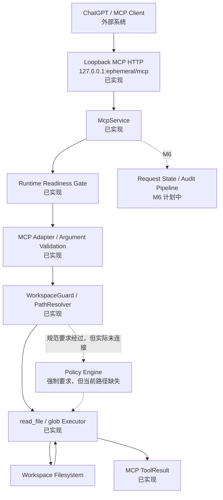

# ChatGPT-Harness Repository Audit Report

## 1. 执行摘要

### 审计快照

| 项目 | 结果 |
|---|---|
| 审计日期 | 2026-09-07 |
| 仓库 | `TotoroKingdom/ChatGPT-Harness` |
| 审计对象 | GitHub `main` 已提交快照 |
| HEAD | `7611cb10337984a510f70501eb29a43d66f28c86` |
| HEAD 提交 | `feat:M5 Final Acceptance Review` |
| 本地目录 | 用户指定 `D:\ChatGPT-Harness`，但 GitHub 无法确认本机工作树状态 |
| 动态验证 | **未执行** |
| 代码修改 | **无** |
| CI 证据 | 当前仓库树未发现 `.github` workflow；本次也没有外部 CI PASS 可作为当前 HEAD 动态验收依据 |
| `CONTEXT.md` | 当前 GitHub 树未发现 |
| approved ADR | 当前 GitHub 树未发现独立 ADR |

HEAD 对应的是一份 **M5 Final Acceptance Review 审核任务文档**，该文档列出了必须执行的 `cargo fmt/check/test` 等最终验证，但它本身不是一份“已经执行并 PASS”的验收结果。 

### 核心结论

**没有发现 P0。**

没有发现静态证据证明 `read_file` / `glob` 可以直接逃逸 `WorkspaceGuard`。相反，当前 Workspace 安全边界设计总体是合理的：路径在文件访问前 canonicalize（规范化），最终使用路径语义判断而非字符串前缀判断，并针对 Windows 特殊路径、symlink（符号链接）和 junction（目录联接）提供了较多测试。

但发现一个 **P1 架构缺陷**：

> 当前真实 MCP `tools/call` 执行链没有 Policy Engine（策略引擎）。

这直接违反 PRODUCT 与 ARCHITECTURE 的强制约束。

PRODUCT 明确规定：

`All executable tool requests pass through validation and policy evaluation.`

位于 `D:\ChatGPT-Harness\docs-ai\PRODUCT.md:79`。

ARCHITECTURE 再次规定：

`Every executable MCP Tool Request passes through validation and the Policy Engine.`

位于 `D:\ChatGPT-Harness\docs-ai\ARCHITECTURE.md:75`。

并进一步禁止：

`No tool may call the Executor directly while bypassing Policy Engine.`

位于 `D:\ChatGPT-Harness\docs-ai\ARCHITECTURE.md:206`。

而当前：

`D:\ChatGPT-Harness\runtime\src\mcp\service.rs:38-47`

中的 `McpService::call_tool()` 直接 dispatch 到：

- `read_file::execute`
- `glob::execute`

没有 Policy Evaluation（策略评估）。

`McpExecutionContext` 也只有：

- `WorkspaceGuard`
- `max_read_bytes`
- `readiness`

没有任何 Policy Engine / Policy Evaluator。`D:\ChatGPT-Harness\runtime\src\mcp\context.rs:12-16`。

因此这是**真实运行路径上的架构不一致，而不是文档猜测**。

---

# 2. 产品边界与规范优先级

## 2.1 本项目是什么

当前 PRODUCT 对边界定义非常明确：

```text
ChatGPT
  │
  │ owns Agent Loop
  ↓
ChatGPT-Harness
  │
  │ controlled local execution
  ↓
Local Workspace
```

V1 不是：

- Autonomous Agent Framework（自主智能体框架）
- Memory System（记忆系统）
- Skills Framework
- Context Compression（上下文压缩）
- SubAgents
- Background Tasks
- Git Agent
- Write Agent
- 通用 Shell Agent
- OS-level Sandbox（操作系统级沙箱）

因此这些能力没有实现，**本次全部按 N/A 处理，不作为缺陷。** 

当前项目方向没有出现“把 Harness 做成 Codex/Claude Code 替代品”的明显越界。

---

# 3. M 编号与 Phase 编号不是同一套阶段

这是当前仓库很重要的一点。

ARCHITECTURE 的 Phase 2 — Read-Only Runtime 明确同时包含：

```text
Workspace
WorkspaceGuard
PathResolver
ToolRequest / ToolResult
Tool Registry
read_file
glob
Policy Engine
MCP registration
Normal Mode catalog
```

即 Architecture Phase 2 本来就要求 Policy Engine。

而 Roadmap 后来把它拆成：

```text
M4 Workspace Security
M5 Read-Only MCP Runtime
M6 Policy / State Machine / Audit
```

Roadmap 明确把 Policy Engine 放到了 M6。`D:\ChatGPT-Harness\docs-ai\Roadmap.md:204+`。

可以近似映射为：

| Roadmap | Architecture Phase |
|---|---|
| M0–M3 | Phase 1 + 部分 Phase 3 基础 |
| M4 | Phase 2 的 Workspace 部分 |
| M5 | Phase 2 的 MCP/Tool 部分 |
| M6 | **Phase 2 剩余 Policy + Audit/State** |
| M7 | Phase 4 Tunnel Integration |
| M8 | Phase 5 Developer/Test Mode |
| M9 | Phase 6 Hardening |

所以不能说：

> “Architecture Phase 5 已经完成。”

目前准确表达应该是：

> **Roadmap M0–M5 已开发到 M5；Architecture Phase 2 仍未完成。**

---

# 4. 已确认的文档冲突

这是本次审核必须明确记录的 Document Conflict（文档冲突）。

### 高优先级规范

PRODUCT：

```text
所有 executable tool request
必须经过
validation + policy evaluation
```

ARCHITECTURE：

```text
MCP Tool Request
↓
Validation
↓
Workspace
↓
Policy
↓
Executor
```

并禁止绕过 Policy。 

### 低优先级规范

Roadmap：

```text
M5
MCP + read_file + glob

M6
Policy Engine
```


更明显的是 M5 Final Acceptance Review 自己要求：

```text
M5 不进入 Policy Engine
M6 再增加 Policy / Audit / Request State Machine
```

约在：

`D:\ChatGPT-Harness\docs-ai\feature\feat5-M5-Read-Only MCP Runtime\M5 Final Acceptance Review.md:598-624`


### 审计判断

按照本项目规定：

```text
PRODUCT
>
ARCHITECTURE
>
Roadmap
>
feature/task
```

所以：

**Roadmap 与 M5 task 不能合法地覆盖 PRODUCT / ARCHITECTURE 的 Policy 强制要求。**

因此不能用：

> “Policy 本来就是 M6 做的。”

来豁免当前执行路径。

但这更像是**里程碑拆分设计与架构规范没有同步更新**，而不是整个 Harness 方向错误。

---

# 5. 仓库覆盖情况

| 模块 | 关键审查对象 | 深度 | 状态 |
|---|---|---:|---|
| 产品/架构规范 | PRODUCT / ARCHITECTURE / Roadmap / AGENTS | 深 | 已审 |
| Control Protocol | `protocol/`, `docs/IPC.md` | 深 | 已审 |
| Config/Secret | CONFIG、Tauri config、Credential Store | 中-深 | 已审 |
| Runtime 生命周期 | `state.rs`, `server.rs`, Tauri Supervisor | 深 | 已审 |
| Workspace | Workspace/Resolver/Guard | 深 | 已审 |
| read_file | executor + MCP adapter | 深 | 已审 |
| glob | executor + MCP adapter | 深 | 已审 |
| MCP Transport | service/http/runtime | 深 | 已审 |
| Policy | 当前路径与现存接口 | 深 | 确认尚未接入 |
| Audit/Request State | 当前状态 | 中 | M6 DEFERRED |
| UI | Client/factory/Tauri command/control path | 中 | 抽样主要入口 |
| tunnel-client | 仓库布局与现阶段边界 | 浅 | M7 DEFERRED |
| CI/build | manifest、测试源码、GitHub状态 | 中 | 未执行 |
| 二进制 tunnel-client | 未分析二进制内部 | 不适用 | M7 后续 |

本报告的“全仓库审核”是**主要模块和核心路径全覆盖**，不是声称逐行人工验证了仓库内每个源文件。

---

# 6. 当前真实架构



当前最关键的问题一眼可以看出来：

```text
规范要求：

Guard
 ↓
Policy
 ↓
Executor


实际代码：

Guard
 ↓
Executor
```

---

# 7. 核心成功路径重建

## `read_file`

真实路径大致是：

```text
External MCP Client
↓
127.0.0.1:<ephemeral>/mcp
↓
rmcp Streamable HTTP
↓
McpService::call_tool()
↓
mcp/read_file.rs
↓
Runtime readiness
↓
arguments deserialize / validation
↓
execute_read_file()
↓
WorkspaceGuard::approve()
↓
PathResolver::resolve()
↓
fs::canonicalize()
↓
workspace boundary check
↓
File::open()
↓
bounded read
↓
CallToolResult
```

HTTP MCP 测试不是纯 Mock：测试代码建立真实 TCP 连接，实际执行 `initialize → tools/list → tools/call read_file/glob`，并验证 workspace escape 返回 `WORKSPACE_VIOLATION`。

因此 M5 的 MCP 能力不是“只有接口”。

---

# 8. Workspace 安全路径

`execute_read_file()` 在文件打开之前首先执行：

```rust
workspace_guard.approve(&request.path)
```

随后才：

```rust
fs::metadata(...)
File::open(...)
```

`D:\ChatGPT-Harness\runtime\src\tools\read_file.rs:114-138`。

`glob` 同样通过 Guard 审核 base path，并且遍历得到每个 candidate 后重新调用：

```rust
workspace_guard.approve(&candidate_path)
```

然后才进入 pending traversal。`D:\ChatGPT-Harness\runtime\src\tools\glob.rs:115-198`。

这部分架构方向是正确的。

本次没有找到：

```text
MCP → fs::read
```

这种绕过 WorkspaceGuard 的生产工具路径。

---

# 9. Runtime 生命周期

静态执行链也是真实连接的。

Runtime initialize：

```text
RuntimeCore.initialize
↓
WorkspaceGuard 创建
↓
MCP context 创建
↓
McpRuntimeService.start
↓
HTTP endpoint 成功绑定
↓
initialize response
↓
initialized notification
↓
Runtime Ready
```

如果 MCP endpoint startup 失败，代码执行 rollback，而不是把 Runtime 错报为 Ready。

停止：

```text
runtime.stop
↓
RuntimeCore stop
↓
readiness false
↓
McpRuntimeService shutdown
↓
HTTP task结束
↓
thread join
↓
stop response
```

测试还明确尝试在停止后重新 bind 原端口，用于证明 listener 已释放。

EOF cleanup 也走统一 shutdown。

因此：

> **“Runtime 生命周期只是状态变量，没有实际控制 MCP Server”**

这个说法不成立。

它已经接通。

---

# 10. 里程碑验收矩阵

| 里程碑 | 正式目标 | 实现证据 | 动态验证证据 | 审计判断 |
|---|---|---|---|---|
| M0 | Control Protocol 冻结 | protocol/docs/IPC/CONFIG/生成模型存在 | 本次未执行 contract tests | **PASS（静态范围）** |
| M1 | Tauri UI Skeleton | 五页、统一 HarnessControlClient、Mock abstraction 存在 | 本次未打开 UI | **PARTIAL** |
| M2 | 配置与生命周期 UX | AppData config、SecretStore、Settings、Start/Stop/Diagnostics 接口存在 | First Run 完整用户流未执行 | **PARTIAL** |
| M3 | 独立 Rust Runtime | executable、stdio control、RuntimeSupervisor、生命周期存在 | 本次没有实际 spawn | **PARTIAL** |
| M4 | Workspace Security Boundary | Guard/Resolver/Workspace 与大量边界测试存在 | Windows symlink/junction tests 本次未运行 | **PARTIAL** |
| M5 | Read-Only MCP Runtime | HTTP MCP、read_file、glob、真实 adapter/executor 已接通 | Final Acceptance commands 本次未执行 | **FAIL（项目规范层级）** |
| M6 | Policy / State / Audit | 规划存在，Policy 执行链不存在 | — | **DEFERRED** |
| M7 | tunnel-client Integration | 后续里程碑 | — | **DEFERRED** |
| M8 | Developer/Test Mode | 后续里程碑 | — | **DEFERRED** |
| M9 | Hardening / Release | 后续里程碑 | — | **DEFERRED** |

这里 M5 的 **FAIL** 需要准确理解：

不是说：

> MCP / read_file / glob 没做出来。

恰恰相反，这些实现已经比较完整。

FAIL 的原因是：

> **按照 PRODUCT > ARCHITECTURE 的正式规范，M5 当前暴露出的 executable MCP tools 已经进入真实执行路径，但它们没有经过强制 Policy Engine。**

如果**只按 Roadmap M5 自己的较窄定义**：

> M5 的静态实现接近满足，但由于这次没有执行 Final Acceptance，最多只能判 `NOT VERIFIED / PARTIAL`，仍不能判 PASS。

---

# 11. Findings

## P0

**未发现。**

当前没有证据表明存在直接 Workspace escape、任意写入或 shell execution。

---

## HARN-P1-001 — 可执行 MCP 请求绕过强制 Policy Engine

**Severity：P1 / High**

**性质：已确认架构缺陷**

**适用约束：PRODUCT / ARCHITECTURE mandatory**

### 规范

`D:\ChatGPT-Harness\docs-ai\PRODUCT.md:79`

规定所有 executable tool request 必须经过 Policy Evaluation。

`D:\ChatGPT-Harness\docs-ai\ARCHITECTURE.md:75`

再次规定同一约束。

`D:\ChatGPT-Harness\docs-ai\ARCHITECTURE.md:206`

明确：

```text
No tool may call the Executor directly while bypassing Policy Engine.
```


### 实现证据

`D:\ChatGPT-Harness\runtime\src\mcp\service.rs:38-47`

`McpService::call_tool()`：

```text
read_file → read_file::execute
glob      → glob::execute
```

直接进入 executor adapter。

`D:\ChatGPT-Harness\runtime\src\mcp\context.rs:12-16`

Context 只有：

```text
WorkspaceGuard
max_read_bytes
readiness
```

没有 Policy Engine。

### 影响

当前仅开放只读工具，因此没有达到 P0。

但安全架构目前实际是：

```text
Validation
→ Workspace
→ Executor
```

而不是规范要求：

```text
Validation
→ Workspace
→ Policy
→ Executor
```

未来如果直接在这个架构上增加能力，就容易形成真正的 Policy bypass。

### 最小修复方向

M6 不应把 Policy 设计成 optional hook。

应该把它插入**唯一 canonical execution pipeline（规范执行管线）**：

```text
MCP
→ Request
→ Validation
→ Workspace
→ Policy
→ Executor
```

并使 executor 的生产入口无法被 MCP adapter 绕过。

### 回归验证

至少验证：

```text
ALLOW read_file
ALLOW glob
DENY precedence
Policy unavailable → fail closed
没有直接 Executor production path
```

---

## HARN-P2-001 — ToolRegistry 并非真正的唯一 Tool Catalog 真源

**Severity：P2 / Medium**

**性质：已确认架构一致性缺陷**

`D:\ChatGPT-Harness\runtime\src\tools\registry.rs` 自己声明：

> Runtime's single source of truth

并硬编码 `read_file/glob` descriptor。

但：

`D:\ChatGPT-Harness\runtime\src\mcp\service.rs:33-35`

又单独：

```rust
vec![read_file_tool(), glob_tool()]
```

而：

`D:\ChatGPT-Harness\runtime\src\mcp\service.rs:38-47`

又使用另一套：

```rust
match name {
    READ_FILE => ...
    GLOB => ...
}
```


因此目前至少存在：

```text
ToolRegistry descriptors
McpService::tools()
McpService::call_tool() dispatch
```

三个需要同步的地方。

M5 自己的 Final Acceptance 又明确要求 ToolRegistry 为唯一真源。

### 当前影响

现在名字碰巧一致，所以功能没有立即坏。

但以后增加：

```text
bash
disabled tool
policy-dependent exposure
runtime readiness
```

时容易出现：

```text
UI 看到 A
MCP 暴露 B
Executor 实际支持 C
```

这是 M6 之前最好收敛的架构风险。

---

## HARN-P2-002 — 当前 HEAD 缺少可证明 M5 Final Acceptance 已执行的证据

**Severity：P2 / Medium**

**性质：测试/证据缺口，不是代码缺陷**

HEAD 的 `M5 Final Acceptance Review.md` 要求最终必须执行：

```text
cargo fmt --all -- --check
cargo check --workspace
cargo test --workspace
git diff --check
```

还要求：

- protocol generated consistency
- MCP HTTP E2E
- Windows workspace tests

全部通过。

但 HEAD 本身是：

```text
feat:M5 Final Acceptance Review
```

提交的是“验收任务/检查清单”。

不是：

```text
M5 Final Acceptance PASS Report
```

本次审计依照你的规则也没有执行这些命令。

所以：

> **M5 不能因为“已有测试代码”而判定动态验收 PASS。**

---

## HARN-P2-003 — 现有资源限制主要约束结果大小，没有完整约束执行工作量

**Severity：P2 / Medium**

**性质：静态确认的可靠性风险**

### read_file

`execute_read_file()` 在应用 `max_read_bytes` 之前先执行：

```rust
for _ in 0..request.offset {
    discard_next_line(...)
}
```

约在：

`D:\ChatGPT-Harness\runtime\src\tools\read_file.rs:140-144`


因此：

```text
offset = 极大值
+
超大文件
```

可能扫描大量数据。

`max_read_bytes` 控制的是返回内容，而不是 skip work（跳过工作量）。

### glob

`glob` 有 `MAX_GLOB_RESULTS=1000`，这是好的。

但 `read_sorted_entries()` 会先：

```rust
for entry in fs::read_dir(path)? {
    entries.push(entry?);
}
entries.sort(...)
```

即先把一个目录全部读入内存后排序。

`D:\ChatGPT-Harness\runtime\src\tools\glob.rs:278-285`。

所以：

```text
result limit
≠
traversal/work limit
```

目前 endpoint 只绑定 loopback，风险有限。

但在 M7 真正通过 tunnel-client 对 ChatGPT 开放以前，建议增加合理的 execution budget（执行预算）设计。

---

## HARN-P3-001 — 仓库提交了本机 Vite 错误日志

**Severity：P3 / Low**

当前存在：

```text
D:\ChatGPT-Harness\ui\vite-exe.stderr.log
```

内容包含：

```text
Port 1420 is already in use
file:///D:/ChatGPT-Harness/ui/node_modules/...
```


`.gitignore` 当前没有日志忽略规则。

没有看到密钥泄露，因此不是安全高危。

但这属于 machine-local artifact（机器本地制品），与“运行数据/日志不应进入 repository data”的设计原则不一致。

建议后续删除该跟踪文件，并加入适合项目的日志忽略规则。

---

# 12. 当前未确认的问题

以下没有足够证据升级成已确认缺陷：

### Workspace TOCTOU

存在理论上的：

```text
canonicalize
↓
approve
↓
filesystem open
```

之间路径对象被外部进程替换的竞争窗口。

但当前威胁模型是本地用户选择的开发 workspace，本次没有足够证据证明这是可实际利用的项目 P1/P2 漏洞。

因此：

**未列为正式 Finding。**

### ToolRequest / ToolResult generic envelope

Roadmap M5 明确写了 `ToolRequest` / `ToolResult`。

当前检查到更多是：

- tool-specific request models
- RMCP CallToolResult
- ToolDescriptor

没有在已检查路径发现完全对应 ARCHITECTURE conceptual `ToolRequest` 的统一 production envelope。

由于 GitHub code search 本次返回结果存在 incomplete 标记，同时 M6 本来就会引入 Request State Machine，因此：

**列为定义待澄清，不直接判 defect。**

---

# 13. 测试架构审核

当前测试总体不是“全是 Mock”。

其中较有价值的是：

### MCP HTTP Integration

`runtime/src/mcp/http.rs` 中直接通过 TCP：

```text
initialize
→ tools/list
→ tools/call
→ read_file
→ glob
```

并测试：

- pre-ack rejection
- Workspace escape
- invalid args
- unknown tool
- Host/Origin
- oversized body
- shutdown/rebind

这是比较真实的模块集成测试。 

### Control Lifecycle

`server.rs` 覆盖：

- invalid initialize retry
- MCP startup rollback
- duplicate initialized
- runtime.stop
- endpoint release
- stdin EOF cleanup


### Protocol Contract

协议层存在：

- fixture schema validation
- generated artifact consistency
- method registry exactness
- DecimalU64 wire contract
- RuntimeLimits contract


所以不能把当前测试体系评价成：

> “Mock Test 冒充 E2E。”

更准确的是：

> **已经有真实模块边界集成测试，但当前 HEAD 缺少可验证的最新执行结果，且尚没有真正的产品级 ChatGPT → tunnel → Harness E2E——后者属于后续 M7。**

---

# 14. 建议的动态验证计划

本次 **全部未执行**。

## Rust 基线

```bash
cargo fmt --all -- --check
```

目标：确认 formatting gate。

副作用：理论上 check 模式不应修改源码。

```bash
cargo check --workspace
```

目标：验证 workspace 编译。

副作用：

```text
生成/更新 target/
编译缓存
```

```bash
cargo test --workspace
```

目标：

- Protocol contracts
- Workspace tests
- Runtime lifecycle
- MCP HTTP integration
- Windows symlink/junction security

副作用：

```text
target/ 编译输出
临时目录
临时文件
loopback socket
Windows symlink/junction test resources
测试 Runtime/process
```

```bash
git diff --check
```

目标：Whitespace/error check。

副作用：无预期仓库写入。

## UI

仓库定义了：

```bash
cd ui
npm test
npm run typecheck
npm run build
```

`package.json` 对应 `vitest run`、`tsc --noEmit`、`vite build`。

其中 build 会生成：

```text
ui/dist/
```

因此属于有文件系统副作用的动态验证。

---

# 15. 三个独立判断

## A. 当前 M5 是否满足验收条件？

### 结论：**FAIL**

原因不是 read_file/glob 不工作。

而是存在确定的高优先级规范违反：

```text
PRODUCT / ARCHITECTURE
要求 Policy

实际 production path
没有 Policy
```

另外，Final Acceptance 动态命令没有当前可验证 PASS 证据。

如果只问：

> “Roadmap M5 写的 MCP + read_file + glob 有没有基本实现？”

回答是：

**静态证据很强，基本实现已经完成。**

但这与“正式验收通过”不是同一个判断。

---

## B. 是否适合进入 M6 — Policy / State Machine / Audit？

### 结论：**GO WITH CONDITIONS**

这是本次最重要的项目推进建议。

我不建议：

```text
回头大改 M5
↓
重新设计整个 Harness
```

因为 M6 正好就是解决当前核心缺口的里程碑。

推荐状态：

```text
M5
= 功能实现完成
= 正式验收保持 OPEN / FAIL

          ↓

M6
= corrective + planned implementation
= 先建立 canonical execution pipeline

          ↓

Policy 接通
State Machine 接通
Audit 接通
重新跑 M4/M5/M6 regression

          ↓

再关闭 M5/M6 gate
```

也就是说：

> **允许开始 M6 开发，但不能把这解释成“M5 已完整 PASS”。**

并且在进入 M7 tunnel-client Integration 之前，P1 必须关闭。

---

## C. 当前是否达到发布/真实使用安全就绪？

### 结论：**NO-GO**

原因很明确：

当前还没有：

```text
Policy Engine
Request State Machine
完整 Audit
tunnel lifecycle integration
Developer/Test approval security
M9 hardening
release E2E
```

其中大部分本来就是未来里程碑，不是当前代码质量缺陷。

所以：

> **可以继续开发，但还不是 V1 Release Ready（发布就绪）。**

---

# 16. 后续行动顺序

## 1. 必须立即处理

先解决规范层冲突。

需要明确一种治理方式：

```text
PRODUCT/ARCHITECTURE Policy requirement
vs
Roadmap M6 sequencing
```

不能继续保留：

```text
高优先级：现在必须 Policy
低优先级：M5 禁止 Policy
```

这种互相矛盾的项目指令。

---

## 2. M6 第一优先级

实现唯一 canonical request pipeline：

```text
MCP Request
↓
Validation
↓
WorkspaceGuard
↓
Policy Engine
↓
Executor
↓
ToolResult
↓
Audit
```

Policy 必须成为安全边界，不是 optional hook。

---

## 3. M6 同时收敛 Tool Registry

避免：

```text
Registry
MCP schema list
MCP dispatch
```

三套硬编码。

建立真正统一的 Tool Catalog / Handler registration。

---

## 4. M6 完成前做动态回归

至少执行：

```text
cargo fmt
cargo check
cargo test
git diff --check
```

重点确认 Windows：

```text
symlink escape
junction escape
UNC
device path
root-relative
sibling-prefix
```

全部真实执行。

---

## 5. 在 M7 前补资源约束

重点处理：

```text
read_file huge offset
glob huge directory
glob traversal budget
request concurrency
```

因为到了 M7，攻击/异常输入边界会从：

```text
local loopback client
```

扩展到：

```text
ChatGPT
→ tunnel-client
→ Harness
```

这时资源限制的重要性明显上升。

---

# 17. 最终审计意见

当前 ChatGPT-Harness **不是一个空壳工程**。

到 M5 为止，已经形成了比较清晰的真实 Runtime 基础：

```text
Tauri Control Plane
        ↓
Runtime Process Supervisor
        ↓
Rust Runtime
        ↓
MCP HTTP Server
        ↓
Tool Adapter
        ↓
WorkspaceGuard
        ↓
read_file / glob
        ↓
Filesystem
```

其中：

- Runtime 真实独立运行架构存在。
- MCP HTTP endpoint 是真实服务。
- read_file/glob 不是 placeholder。
- WorkspaceGuard 确实处于生产调用路径。
- lifecycle 与 shutdown 已经形成闭环。
- 测试不是只有 Mock。

最大的架构风险不是 Agent Loop、Memory、Context、SubAgent，也不是缺 OS Sandbox。

这些本来就不属于这个产品。

**最大的风险只有一个非常具体的问题：**

> **当前安全执行链在 WorkspaceGuard 后直接进入 Executor，没有执行 PRODUCT / ARCHITECTURE 强制要求的 Policy Engine。**

因此最终判定：

```text
M5 正式验收：
FAIL

进入 M6 — Policy / State Machine / Audit：
GO WITH CONDITIONS

进入 M7 — tunnel-client Integration：
NO-GO，直到 M6 Policy 安全链与动态回归完成

当前 V1 发布/真实使用：
NO-GO
```

项目当前最合理的动作不是继续横向增加能力，而是：

```text
冻结 M5 功能面
        ↓
进入 M6
        ↓
把 Policy / State / Audit
插入现在已经打通的 Runtime 主链
        ↓
统一 Tool Registry
        ↓
跑一次 M4–M6 完整动态安全回归
        ↓
再开始 M7
```

这是基于当前代码实际结构最小、最顺的推进路径。