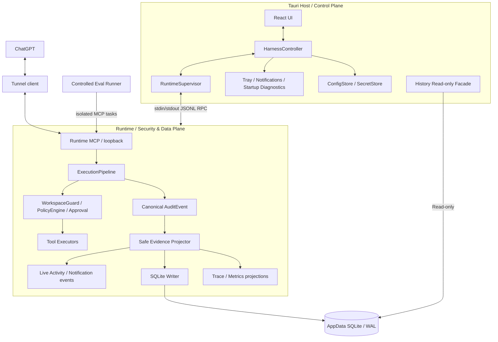
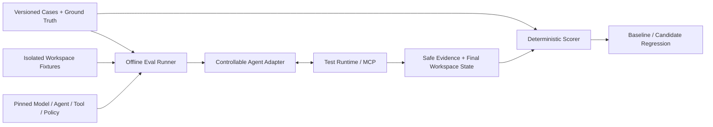

# ChatGPT-Harness V4 Architecture

> **Status:** V4 UPSTREAM PLANNING BASELINE / FROZEN FOR M00 (2026-10-23)  
> **Target:** Windows-first V4; not an implementation or acceptance statement  
> **Product contract:** [V4 PRD](./ChatGPT-Harness_V4_PRD.md)  
> **Inherited reference:** [V3 Architecture](../docs/archive/v3-2026-10/ChatGPT-Harness_V3_ARCHITECTURE.md)  
> **As-is source:** source code, tests, manifests, [current Wiki](../wiki/ARCHITECTURE.md)  
> **Next:** V4 Roadmap → M00 SPEC → PLAN → TASK → gated verification  
> **Freeze semantics:** 本文当前冻结为 M00 的上游目标架构基线；M00 负责用源码、POC 与真实链路验证技术假设。M00 若证明某 ADR 不成立，必须先显式修订并重新冻结本 Architecture / PRD / Roadmap 的受影响部分，不能在下游 TASK 中静默改语义。

---

# 1. Executive Architecture Decision

**V4 沿用 V3 已建立的核心进程边界，不重写 Harness Kernel，不新增独立常驻 daemon，也不建立第二套 PolicyEngine。**

职责保持：

- **Tauri Host**：桌面生命周期、ConfigStore、SecretStore、HarnessController、RuntimeSupervisor、TunnelProcessManager；新增 Tray / Notification / Startup Diagnostics。
- **Runtime**：MCP Service、ToolRegistry、CapabilityGate、WorkspaceGuard、PolicyEngine、ApprovalManager、SessionGrantStore、ExecutionPipeline；新增安全证据投影和 SQLite 正常运行时写入。
- **Tunnel**：仍仅承担外部 ChatGPT ↔ Runtime MCP 的连接桥接。
- **React UI**：状态展示、用户请求和操作意图；不得自行计算 Ready / Policy / Approval。
- **Offline Evaluation Runner**：独立、可控的 Agent 工具质量评测；不作为生产 Runtime 的另一个 Agent Loop。

**新增架构中的关键决定：Runtime 产生并写入执行证据；Tauri 通过共享的只读存储访问层支持 Harness 停止时的历史查询；运行时只允许一个 SQLite writer。**

本文件是**目标架构草案**。旧 V3 Architecture 是历史目标设计；冻结本 Architecture 前必须以当前源码和测试重新核实每项已实现行为，V3 单项 Milestone 的 ACCEPTED 不等于 V3 整体正式验收。

# 2. Current Code Baseline (verified)

| 当前源码事实 | 证据 |
| --- | --- |
| Tauri 2 Rust Host、commands 与 dialog plugin | `ui/src-tauri/src/lib.rs`, `ui/src-tauri/Cargo.toml` |
| HarnessController 已串行管理 Start/Stop/Restart 和生命周期状态 | `ui/src-tauri/src/harness.rs` |
| RuntimeSupervisor 管子进程、generation 与 JSONL Control RPC | `ui/src-tauri/src/runtime/mod.rs` |
| Runtime MCP 使用 rmcp Streamable HTTP，绑定 loopback | `runtime/src/mcp/http.rs`, `runtime/src/mcp/service.rs` |
| ExecutionPipeline 具有 ExecutionPermit、AuditSink、Approval/Grant 依赖 | `runtime/src/execution/pipeline.rs` |
| AuditEvent 已具 event_id、request_id、分类与安全结果 | `runtime/src/audit/event.rs` |
| ActivityStore 当前为 Runtime 内存有界队列，容量 256 | `runtime/src/activity/mod.rs` |
| ActivityEventInput/EventBus 是另一条实时 UI 投影链 | `runtime/src/events.rs`, `protocol/src/v1/activity.rs` |
| Runtime 持有 Pending Approval，绑定 request/runtime 身份 | `runtime/src/approval.rs`, `protocol/src/v1/approvals.rs` |
| 当前 AppConfig 为 schema v2；UiConfig 不传 RuntimeConfigSnapshot | `protocol/src/v1/config.rs`, `ui/src-tauri/src/config/mod.rs` |
| ToolRegistry/ToolConfig/ToolPolicyDefaults 均显式枚举工具 | `runtime/src/tools/registry.rs`, `protocol/src/v1/config.rs` |

上表不代表 V4 新功能已经实现。特别是当前未核实存在 SQLite History、Tray、Windows Notifications、grep、完整 Agent Evaluation。

# 3. V4 Architectural Invariants

1. 所有 Tool 仍走 `McpAdapter → ExecutionPipeline → WorkspaceGuard → PolicyEngine → Approval → Executor`；只有既有安全链路可以生成 `ExecutionPermit`。
2. Runtime 是唯一权限真相；Activity、History、Metrics、Trace、Evaluation、Simulator 只观察真实 Runtime 决策。
3. Runtime 生效配置保留 immutable generation，desired 与 effective state 分离。
4. durable evidence 永远不能恢复旧 Pending Approval、SessionGrant 或 Permit。
5. canonical evidence 只从同一个 ExecutionPipeline/Audit 事件源产生，禁止 UI、Tauri 或统计模块重新计算授权与执行结果。
6. 历史字段最小化、枚举化、有界化；禁止 raw keys、raw env、无限输出、实际敏感文件内容及未经处理的物理路径。
7. Telemetry failure 不能生成额外 ALLOW、改变 Runtime Policy 决策、把不完整证据伪报为完整。
8. Tauri 仍是生命周期唯一 owner；进程存在不等于 Ready，通知投递不等于恢复，DB 可读不等于授权有效。
9. Control wire protocol 优先 additive evolution；产品 V4 不要求直接创建 `protocol/v2`。
10. Windows-first；不承诺云端 DB、远程审批、完整 OS Sandbox、ChatGPT 隐藏模型思考或 Agent Loop Trace。

# 4. Architecture Decision Records

| ADR | 决策 | 取舍 |
| --- | --- | --- |
| A01 | 继承 React / Tauri / Runtime / Tunnel 四层边界 | 不重写 V3 核心 |
| A02 | Tray/通知/窗口 Close/Quit 由 Tauri Host 负责 | React 不承担后台存活责任 |
| A03 | 使用 Tauri 2 内建 TrayIconBuilder + 官方 notification plugin | Windows Toast 点击与 Action Center 回调需打包实测 |
| A04 | Runtime 的 AuditEvent 为 canonical evidence source | 禁止多来源统计口径 |
| A05 | SQLite 正常运行时只由 Runtime 写，Tauri 以只读连接查询 | 可靠保留终端执行事件；离线查询需共享 DAL |
| A06 | 增加内部 `evidence-store` Rust library 共享 DTO、Migration、Query 与 Maintenance | 代码复用，不共享授权能力 |
| A07 | SQLite WAL + versioned migration + bounded writer queue + retention | 存储失败显示证据缺口，不影响 Policy 真相 |
| A08 | `runtime_id + request_id` 为单 Tool Request 主关联键 | Host session/generation 必须明确映射，不按时间猜 |
| A09 | F14 定义为 MCP Tool Request Trace | 不冒充完整模型 Agent Trace |
| A10 | F12 使用独立 Offline Controlled Runner + ground truth | 被动 MCP 调用统计不能计算选择准确率 |
| A11 | F05 主启动耗时由 Tauri monotonic clock 测量 | 禁止跨进程 Instant 相减 |
| A12 | F10 grep 属于 WorkspaceRead，通过已有执行管线 | 不通过隐藏 shell grep 绕过 Policy |
| A13 | F11 候选工具需 Admission Gate | P1 不强制实现全部文件工具 |
| A14 | F15 复用 Runtime PolicyEngine 的无副作用评估入口 | 不创建 Permit/Approval/执行 |
| A15 | AppConfig V4 迁移方向固定为 v2→v3；Control Protocol v1 增量升级 | Host-only prefs 不生成 Runtime restart debt；具体字段与 migration fixture 在 M00 / 对应 SPEC 冻结 |
| A16 | P95 从原始有效样本计算，不平均多个 P95 | 样本不足标 INCONCLUSIVE |
| A17 | 默认 History/Trace 为非授权组件 | 强制审计可用才能执行属于未来独立 PRD/ADR |
| A18 | MCP conformance 锁定协议 revision、SDK 和工具版本 | 协议兼容与真实 ChatGPT E2E 分开验收 |

以上 ADR 是 **M00 的规划基线决策**。M00 必须验证其中标注的技术假设、POC 与当前源码兼容性；验证通过后形成 implementation-frozen contract。若 M00 发现某决策不可行，应先修订上游文档并记录替代 ADR，而不是在 SPEC / TASK 中自行漂移。对于影响用户行为的变更必须先修改 PRD。

# 5. Target Topology and Ownership



**图的含义**：Runtime MCP 实际由 Tunnel 访问；React 不直接调用 MCP HTTP。离线评测应使用隔离测试实例，而非向真实用户正在运行的工作空间注入测试任务。

| Capability | Authority / writer | Read path |
| --- | --- | --- |
| Harness lifecycle/Ready | Tauri HarnessController | Host state → UI/Tray |
| Policy、Tool availability、Approval、Permit | Runtime | live Control RPC |
| Safe execution evidence | Runtime AuditEvent | projection adapter |
| SQLite running-state writes | Runtime-only | Tauri read-only shared store |
| SQLite offline maintenance | Tauri, only after Runtime stopped + exclusive lock | Tauri UI façade |
| Agent evaluation outcomes | controlled runner + deterministic graders | Evaluation results viewer |
| Windows Toast / tray | Tauri DesktopCoordinator | OS/UI events |

# 6. Desktop Background and Notifications (F01–F04)

建议新增 Host 内部 `DesktopLifecycleCoordinator`、`TrayController`、`NotificationCoordinator`、`NotificationRouter`。不需要独立后台 daemon。

**Window close**：拦截 `CloseRequested`；新安装默认隐藏主窗口、保留 Tauri event loop、Runtime/Tunnel/待审批；Tray 的 Show/Start/Stop/Quit 全部调用已有 HarnessController 串行操作。第一次隐藏显示一次可关闭的后台驻留提示。

**Explicit Quit**：标记 `app_quitting` 防止 Auto Start 或 Tray Start 竞态；现有 operation mutex 执行 Stop；停止受管 Tunnel/Runtime/子进程，发出有界 evidence drain，完成后退出。OS 强杀或 crash 不能被宣传成优雅退出。

**Auto Start**：新安装默认 false；在初始化 ConfigStore/SecretStore 与 Host lifecycle 后仅调一次标准 `harness_start`，并使用同一个 operation mutex 合并/拒绝重复 Start；失败走现有 error/diagnostics flow。不是 Windows 登录自启动。

**Approval Notification**：由 Host 订阅来自 Runtime 的安全 Pending 事件，按 `runtime_id + approval_id` 去重。点击 Toast 时主窗口 Show/Focus，再向 Runtime 查询真实状态；可能为 Pending、Resolved、Expired 或 Runtime gone。不可恢复 Pending 时只展示历史终态，绝不恢复授权。

**Disconnect Notification**：按照 session/incident episode 的权威状态转换去重（首次重要失败、恢复、再次独立失败）。持续 poll 不重复通知。每类通知单独可控，通知文字禁 raw argv/secrets/path。

**Windows failure boundary**：OS 通知被关闭或点击事件不可靠时，Tray 待审批计数及 Approval Center 是永久 fallback。Windows Action Center 旧 Toast 点击回调不可假设始终可用；打包安装环境实测。Tray 绝不凭缓存的进程 PID 伪造 Ready，要响应 supervisor freshness、Degraded 和后续状态收敛。

# 7. Startup Performance and One-click Diagnostics (F05–F06)

`StartupPhaseRecorder` 由 Host 记录每次 Start 的：

1. Config + eligibility；
2. Runtime spawn；
3. Runtime initialized/ready；
4. MCP endpoint 获取与可达；
5. Tunnel resolve/launch；
6. control-plane connection；
7. configured MCP target readiness；
8. authoritative final Harness Ready。

每个阶段存 `session_id`、阶段标识、Host monotonic duration、状态、sanitized error、软件/环境版本。单次 Start→Ready 由 Host 单调时钟计算；进程内独立阶段只传 duration，不将两个进程的 monotonic timestamp 直接相减。

F05 SPEC **在开发前**基于同硬件/配置/网络下 cold/warm 重复样本冻结 baseline、P50/P95、失败率和优化目标；仅新增埋点不算优化通过，跳过 readiness 检查更不算。

`DiagnosticsCoordinator` 聚合 Host 配置/Workspace/Runtime/Tunnel/Proxy/SecretReference 存在性、Runtime 权威状态与 Tunnel health，返回 typed `PASS | WARNING | FAIL | UNKNOWN`、scope、safe evidence、remediation。默认只读；改变配置、重启进程等修复动作需要用户单独授权。History 旧数据不能被用于判定**当前**连接健康。

# 8. Shared Evidence Contract (Core P0 prerequisite)

当前存在 `AuditEvent → ActivityStore` 和 `AuditEvent → ActivityEventInput → EventBus → Tauri` 两个合法观察投影。V4 在原有 AuditEvent 生产点加一个 `SafeEvidenceProjector`，**同一事件**分发给 live activity、Host 通知、SQLite writer 和 Trace/Metric projection，禁止新的模块重新判定 Policy。

建议版本化逻辑事件：

```text
EvidenceEvent {
  schema_version, event_id: UUIDv4,
  runtime_id, request_id?: UUID,
  host_session_id?: confirmed_mapping_only,
  trace_id?, span_id?, parent_span_id?,
  approval_id?, tool_name?,
  occurred_at_utc, recorded_at_utc, source_sequence?,
  stage, lifecycle_state, outcome?, failure_category?,
  policy_decision?, policy_reason?, matched_rule_ids?,
  duration_ms?, bytes_in?, bytes_out?, truncated?,
  sanitized_args?, sanitized_result?,
  coverage: COMPLETE | INCOMPLETE | UNKNOWN
}
```

**Identity**：单次 MCP Tool 请求以 `(runtime_id, request_id)` 关联。event_id 全局去重；本地 trace_id 为独立生成的单请求 trace，不代表上游 ChatGPT traceparent。Host active_session_id、Host supervisor generation、Runtime runtime_id、Approval generation_id 是不同概念，只有握手取得映射时才能关联，不能仅因时间相近就视为同一个 ID。

**Result**：`tool requested` ≠ `executor started`；Policy DENY ≠ executor failure；ASK Pending ≠ execution success；tool returned OK ≠ Agent task achieved。若 crash/timeout 只看到部分阶段，显示最后已知状态及 INCOMPLETE，不伪造 Success/Failed 终态。

**Sanitization**：证据字段必须采用 typed allowlist、长度上限与结构化枚举，允许逻辑相对路径、安全摘要、rule ID、duration/size/count/hash；禁止 raw secret/argv/env/stdout/stderr、任意真实物理路径和未界定文件正文。新增 grep/file tools 必须增加经过安全测试的专属 sanitized evidence variant，不能放行任意 JSON。

# 9. SQLite Evidence Store (F07)

## 9.1 Ownership

新增建议的 `evidence-store/` 内部 Rust crate，包含 shared safe DTO、SQLite schema/migrations、query + retention DAL，不包含 PolicyEngine 或执行 Permit。

- **Runtime running**：Runtime 是唯一 writer；Tauri 用共享 DAL 以 read-only connection 查询。Tauri 不可边读边自行迁移/删除。
- **Runtime stopped**：Tauri 在验证进程已退出并取得独占 maintenance lock 后可进行 clear / retention maintenance / 必要升级；应用重启不依赖启动 Runtime 才能浏览已兼容的历史。
- DB path 来自 Tauri 受控 `app_data_dir()`，由私有 runtime launch config 传递，不在 Agent Workspace 或 MCP Tool args 中暴露；Runtime 校验目录并且不得将其作为可执行工具工作目录。

选择 Runtime writer 的原因：它能在产生安全 AuditEvent 的位置就安排持久化，减少依赖 Tauri UI 事件桥传输后在崩溃边界丢掉末尾事件。代价是 Tauri offline read / exclusive maintenance 的并发方案必须测试。

## 9.2 Logical schema (physical DDL frozen in SPEC)

| Table | Key fields |
| --- | --- |
| schema_migrations | version, applied_at, checksum |
| runtime_sessions | runtime_id, optional host_session_id, start/end/end_reason |
| request_summary | runtime_id, request_id, tool, first/last_seen, status, evidence_coverage |
| evidence_events | event_id PK, runtime_id, request_id, stage, safe fields, timestamp |
| approval_history | runtime_id, approval_id, request_id, terminal state, safe fields |
| request_spans | trace_id, span_id, parent?, runtime_id, request_id, duration, status |
| evidence_health | last_commit, drop_count, last_error, checkpoint |

Index：request identity、(time,event_id) descending、tool+time、outcome+time、approval_id。查询使用 bounded keyset pagination，不允许把整库记录直接交给 React。表字段必须使用 typed allowlist DTO，不能对未来 AuditEvent 任意自动序列化后持久化。

## 9.3 Durability, corruption, upgrades

启用 SQLite WAL、foreign_keys、busy_timeout、单 writer connection。有界 async queue + batching，ExecutionPipeline 不能每步执行无界同步 fsync；事务提交 event 与关联 summary，event_id 做幂等去重。正常 Stop 时有界 drain，强杀留下未完成请求标 INCOMPLETE；不按猜测补写成功。

满队列/磁盘不足/写入失败时：保留 Runtime Policy 原判定、上报 `EVIDENCE_DEGRADED` 与丢失计数、提示哪些历史可能不完整；不能表面显示完整 SUCCESS。数据损坏、schema version 不兼容或 migration 失败时保留旧库，先做一致性备份 + 事务迁移，禁止自动删除重建掩盖丢失。第二个 writer 未能取得所有权应拒绝启动写入而非并发竞写。

## 9.4 Retention, privacy and clear

建议默认 **30 天 / 256 MiB**，以先达到的限制触发清理，最终数字必须在 Milestone SPEC 与 PRD 产品决策一致后冻结。按整个 request 及关联 spans/approvals/events 做原子清理，避免孤儿数据；用户可查看容量、期限并显式手工清理。运行时清理经 Runtime maintenance RPC 排队；停机时 Tauri 独占维护，不触碰业务 Workspace 文件。

默认依赖 OS 当前用户文件权限、受控 AppData 目录和最小化字段保护；**不宣称 SQLite 已做静态加密**。若以后引入加密/同步，单独增加密钥管理 ADR。

# 10. Metrics, Token Estimates and Request Trace (F08/F09/F14)

F08 以完整 canonical events 计算：

- received calls；
- execution attempts / success / failure；
- policy denied / cancelled / timed out；
- execution duration；
- approval wait；
- full request wall time。

执行成功率建议定义为 `successfully completed executor attempts / terminal executor attempts`；DENY、AwaitingApproval、transport 成功但任务失败须单独展示。统计明确过滤区间、Tool、样本量、unknown/incomplete 计数。**P95 对筛选后的原始 duration 计算 nearest-rank 分位数，不平均每日 P95**；样本不足显示 INCONCLUSIVE，具体 sample gate / SLA 在 SPEC 冻结。

F14：每个 MCP request 形成 Runtime 内的 request-local trace：received → tool resolve → WorkspaceGuard → Policy → approval wait? → execution? → terminal/incomplete。Span 由 canonical stage 产生，不能伪造 ChatGPT 模型未下发的 Tool 决策、内部推理或完整 Agent Loop。trace_id、span_id、parent_id 与 request key 关联，缺失阶段明确 UNKNOWN。若以后接 OpenTelemetry，另定义 traceparent / exporter 兼容，不自动宣称端到端追踪。

F09（P2）：记录 input/output bytes、chars、truncation、`estimated_tokens`、estimator_name/version；估算算法留在 SPEC，但必须可版本化，并始终标 `estimated`，不冒充真实模型 billed tokens。不得为估算持久化 raw 文件全文。

# 11. Tool Extensions (F10/F11)

**F10 grep（P0）**：新增 WorkspaceRead capability，依次接入 ToolRegistry、ToolConfig、ToolPolicyDefaults、MCP schema/adapter、ExecutionPipeline、WorkspaceGuard、Typed Result Evidence、UI 与 Evaluation fixtures。搜索参数支持 literal / regex、relative scope、include/exclude、行号、max_results、max_output_bytes；使用 Rust bounded regex/search，不通过 shell grep 绕过 Runtime Guard。检查 Windows symlink/junction/reparse point、TOCTOU、二进制文件、无效正则、不可读文件、扫描时间/字节和结果截断，不能扫描 Workspace 外。

**F11 文件扩展（P1）**：候选 mkdir/list/copy/move/rename/delete 分别提交 `ADMIT / REJECT / DEFER` 的 Tool Admission Decision，包含真实场景、现有工具覆盖、Schema 歧义、安全模型、评测回归。正式纳入的每个工具仍走完整 ExecutionPipeline；涉及 source/destination 的操作需双路径 Guard、文件覆盖/跨卷/中间态与不可逆性处理。**P1 的产品门禁是候选工具准入决策，不是所有候选功能都要实现**。

# 12. Controlled Agent Evaluation (F12, Core P0)



Runner 建议作为仓库独立 `evaluation/` CLI + test fixtures，**不**嵌入生产 Runtime Agent Loop。使用真实 Tool Runtime、隔离 Workspace、可清理测试账号与有界 step/time/spend，不得借开发模式跳过 Workspace/Policy/Approval。Ground truth 包含 prompt/task、允许工具选择集、参数约束、预期最终业务状态、Policy/Approval 预期、fixture hash。

每次 run 锁定 dataset/hash、模型/adapter 版本、Tool schema hash、Policy/config、commit、环境、评分器版本、重复次数与随机性控制。分开打分：Tool selection accuracy（需要 ground truth）、parameter validity、runtime call outcome、最终 task completion、额外无效调用。Transport returned success 不等于任务成功。样本不足或不稳定为 INCONCLUSIVE；SPEC 应在候选开发前冻结回归阈值和阻断条件。

**Production passive telemetry** 只知道模型实际发起的 tools/call，无法得出“本来该调用什么工具”、未发起选项或模型内部推理。无可控 Agent Adapter / ground truth / Runner 真实执行时 F12 必须 BLOCKED，不能只用 Runtime 日志冒充完成。

# 13. MCP Conformance (F13, P1)

锁定被测 MCP spec revision、rmcp SDK version、Streamable HTTP transport、客户端/SDK 组合，并验证 initialize、tools/list、schema、tools/call、unknown-tool、invalid-arguments、structured errors、disabled/unavailable、cancel/timeout（协议适用时）。优先使用官方 [MCP Conformance Suite](https://github.com/modelcontextprotocol/conformance) 并锁定运行器版本，保存实际 output 与不支持案例；**官方 protocol conformance、Harness-specific security semantics、真实 ChatGPT → Tunnel E2E 是三类不同证据**，不得互相替代。需要 wire incompatible change 则显式 major bump + handshake fail fast。

# 14. Policy Simulator (F15, P2)

新增 Runtime-only `PolicyPreviewService`，消费 effective ToolRegistry、WorkspaceGuard 的**无副作用验证**、PolicyEngine 同一 compiled snapshot 与 Bash typed analysis，返回 `ALLOW | ASK | DENY | UNKNOWN`、reason、matched rules、would_require_approval、runtime/config identity、`simulated=true`。不调用 executor、不创建 ExecutionPermit、Pending Approval、Session Grant，不启动 bash、不写 Workspace。不能安全确认的动态条件返回 UNKNOWN 而非假 ALLOW。真实请求执行时始终重新校验；旧模拟结果不是授权票据。Simulator usage 如要记录必须与真实执行证据隔离。

# 15. Control Protocol, Config and Upgrade

**Protocol** 保留 `protocol/src/v1`；增量扩展 typed DTO + methods + Serde/JSON Schema/TS fixtures + Rust/Tauri/React tests，避免隐式 wire breaking。建议控制 API（实际命名由 SPEC 冻结）：

| Logical API | Owner | Semantics |
| --- | --- | --- |
| history.query / history.get | Tauri facade | 可在 Runtime 停止时 read-only 查询 |
| history.clear | Runtime 在线 writer / Tauri 离线 exclusive maintenance | 显式授权、无孤儿记录 |
| evidence.status | Runtime + Host projection | writer/drops/coverage |
| metrics.query / trace.get | Tauri shared DB read facade | 统一 evidence 语义 |
| diagnostics.summary | Tauri aggregation | read-only by default |
| policy.simulate | Runtime control RPC | only no-side-effect preview |
| evaluation.results.list | Offline eval result facade | 不假设能读取 ChatGPT 内部信息 |

**Config** 的 V4 迁移方向冻结为 `AppConfig schemaVersion 2→3`；具体新增字段、默认值和 migration fixture 在 M00 / 对应 Milestone SPEC 冻结。迁移必须原子并保留全部 Workspace/Tunnel/Proxy/Security/Tools/Policy/Bash/SecretReference：

```text
AppConfig v3
├ existing V3 config fields
├ desktop (host-only)
│  ├ auto_start_harness_on_app_launch: false
│  ├ approval_notifications: true
│  └ connection_notifications: true
└ history
   ├ enabled: true
   ├ retention_days: 30
   └ max_storage_mib: 256
```

Host-only prefs 不进入 RuntimeConfigSnapshot，也不推进 Runtime configRevision。History 的存储策略可作为 Runtime generation-effective 配置；更新时必须提示 desired/effective 与重启生效边界。DB 路径由 Host 受控 AppData 派生，不接受 Tool 参数指定。grep 还需加入显式 ToolConfig/Policy 默认值和 migration；不允许由于旧配置缺字段出现意外暴露或隐式禁用。迁移失败不得损坏原配置，不把密钥转存为明文。

# 16. Observability Failure and Security Semantics

| Failure | Runtime authority | UI/Evidence |
| --- | --- | --- |
| Main window hidden | Harness stays live | Tray/Notification available |
| Explicit Quit | Serialized stop + process ownership cleanup | Bounded evidence flush |
| Runtime crash | Pending/Grants expired/cancelled, no stale Ready | Incomplete trace/history; no fake terminal |
| Tunnel lost/stale | Leave authoritative Ready | De-duplicated incident and remediation |
| Windows Toast blocked | Approval remains in Runtime | Tray/Approval Center fallback |
| SQLite full/busy/corrupt | Policy unchanged, no implicit ALLOW | EVIDENCE_DEGRADED + loss/coverage indicator |
| Writer channel overflow | No policy mutation | drop count, acceptance gate blocked |
| Migration incompatible | Preserve existing files | Safe read-only/error path, not auto-delete |
| Invalid Policy/Workspace | Runtime fail-closed | typed denial evidence |
| Notification click after expiry | No reactivation | Show actual terminal/history state |
| Eval adapter unavailable | Production unaffected | F12 BLOCKED/INCONCLUSIVE |
| Simulation uncertain | No executor | UNKNOWN; no approval creation |

**明确策略**：当前 V4 默认存储是观察能力而非授权许可。不能因 DB 失败把本应拒绝的操作改为 ALLOW；也不得将 telemetry 错误误判为 Policy DENY。对于关键证据无法保存必须明确告警和阻断产品验收。若要强制“审计持久化成功才能运行破坏性工具”，这是安全产品语义变更，必须单独修订 PRD/ADR 再实现，不能暗中引入。

# 17. Performance and Resource Contracts

- F05：Host Start→Ready monotonic duration，cold/warm 与 stage P50/P95、失败率，目标在开发前由 SPEC 冻结。
- SQLite：bounded queue、batching、writer latency/overflow/drop counters、WAL checkpoint、30 天/256 MiB 默认建议；按 request 原子清理。
- History：稳定 keyset cursor，缺省 50/页、建议最大 200/页，具体查询 SLA 在 SPEC 冻结。
- Metrics：对原始 duration 计算准确 P95，显示样本数与 INCOMPLETE，不能报告不明分母的 success rate。
- grep：bounded regex/time/files/bytes/results/output；极端路径与恶意 pattern 在安全测试下必须受控。
- Evaluation：max steps/time/spend、版本化固定 fixtures、ground truth、成本与不稳定样本处理。
- 后台通知：逐 incident 去重，所有 notification/telemetry 失败不能阻断或改变 Runtime 的安全决策。

# 18. Module Ownership / Implementation Landing Zones

| Capability | Target modules |
| --- | --- |
| Desktop background/tray/notification | new `ui/src-tauri/src/desktop/*` + `lib.rs` + `harness.rs` |
| Startup phase & connection diagnostics | `ui/src-tauri/src/harness.rs`, `runtime/*`, `tunnel/*` |
| Canonical events / safe projections | `runtime/src/audit/*`, `execution/*`, `state.rs` |
| SQLite schema/query/migration | new shared `evidence-store/` + Runtime writer adapter + Tauri facade |
| History / Stats / Trace UI | `ui/src/pages/activity/*`, services + Tauri commands |
| grep | `runtime/src/tools/*`, `runtime/src/mcp/*`, `protocol/src/v1/*` |
| Offline Evaluation | new `evaluation/` CLI + fixtures/report |
| Simulator | `runtime/src/policy/*`, control DTO + UI |
| v3 Config | `ui/src-tauri/src/config/*`, `protocol/src/v1/config.rs` |

这些是**建议的代码落点**，不是当前已存在的文件或提交。实现阶段优先复用现有模块，禁止额外创造同义执行链。

# 19. Validation Plan and Release Gates

**Unit / contract:** config v2→v3 正反向异常与 SecretReference 保留；协议 typed fixtures；event 去重/关联/脱敏；writer lock、WAL reader、离线 History、migration backup、retention 无孤儿；overflow/full/corruption；Tray Close/Quit 竞态；Notification dedupe；grep junction/symlink/TOCTOU/regex；Evaluator golden fixtures；Simulator 与真实 PolicyEngine 的无副作用等价测试。

**Integration:** 真实 Runtime MCP read/grep/ASK/失败路径→History/Trace/Metrics；Runtime Crash/Restart 后历史可查、旧 Pending 不能批准；Tauri Hidden Window 后可继续请求，点击 expired Toast 得到真实终态；真实 NSIS/Portable 安装包 Toast/Tray 验证；F13 官方协议一致性单独执行。

**External E2E:** 真实 ChatGPT → Tunnel → Runtime MCP → Tool/Policy/Approval → Execution → Evidence；外部 MCP 测试不能被 mock 或 `process exists` 冒充，任何需要授权的外部/集成测试在执行前取得许可。

| Gate | Required architecture evidence |
| --- | --- |
| Core / P0 | F01/F03/F04/F05/F06/F07/F10/F12 + Shared Evidence Contract，既有 V3 安全回归与真实 ChatGPT E2E |
| Full / P1 | Core + F02/F08/F11/F13/F14；F11 为候选工具准入结论，不要求实现全部候选 |
| Optional / P2 | F09/F15 若未交付标 DEFERRED；若交付必须各自 PASS |
| V4 — ACCEPTED / FROZEN | Full Gate 全通过、交付的 P2 已验收、证据链可追溯；未执行标 NOT_VERIFIED/BLOCKED |

# 20. Recommended Roadmap and M00 Implementation-Freeze Gate

1. **As-Is & Contract Gate**：重新验证 V3 实现、Protocol/Migration、SQLite ownership 原型、Shared Evidence Contract；锁定核心 ADR。
2. **Desktop Continuity**：Tray、Close/Quit、Auto Start、通知、启动诊断；可与证据层并行。
3. **Durable Evidence**：SQLite writer + offline reader、migrations、retention、History、failure observability。
4. **Quality & Visibility**：F12 controlled runner + **扩展工具前 baseline**；同时构建 Metrics / Request Trace。
5. **Tool Expansion**：grep 回归比较；F11 候选 Admission；F13 Conformance；F09/F15 视范围实施。
6. **End-to-end Acceptance**：Core / Full / Optional 分 Gate 提交测试证据、缺陷、阻断与最终版本结论。

**M00 将本 planning baseline 提升为 implementation-frozen Architecture Contract 的前置检查：**

- [ ] 已核对当前源码、Tests、Manifests 与 V3 Milestone 的 As-Is 基线
- [ ] SQLite 运行时 writer/停机 reader/维护锁/迁移原型验证
- [ ] SafeEvidenceProjector 可以沿用当前 AuditSink，且不存在第二套权限判断
- [ ] Windows Tray/Toast 点击和 Action Center fallback 经实际安装包验证
- [ ] AppConfig v2→v3 migration 与 Runtime generation/restart 债务明确
- [ ] F12 存在真实可执行的 Model/Agent Adapter 和 ground truth dataset
- [ ] grep 及候选工具不绕过 Runtime 执行管线
- [ ] MCP conformance runner、协议修订版本和 ChatGPT E2E 的证据边界明确
- [ ] PRD Core/Full/Optional release gate 无冲突

---

## References

- [V4 PRD](./ChatGPT-Harness_V4_PRD.md)
- [Historical V3 Architecture](../docs/archive/v3-2026-10/ChatGPT-Harness_V3_ARCHITECTURE.md)
- [Current Architecture Wiki](../wiki/ARCHITECTURE.md)
- [Tauri 2 Tray](https://tauri.app/learn/system-tray/)
- [Tauri 2 Notifications](https://v2.tauri.app/plugin/notification/)
- [MCP Official Conformance](https://github.com/modelcontextprotocol/conformance)

> **Design status reminder:** 本文已作为 V4 上游 planning baseline 冻结，但不是实现证明。新模块名、DTO 和 method 仍可在不改变 ADR / PRD 语义的前提下由 Milestone SPEC 精化；任何改变 Authority、security boundary、release gate、migration direction 或 canonical behavior 的方案必须先走上游 change control。M00 通过后再将经验证的 Architecture Contract 标记为 implementation-frozen。
