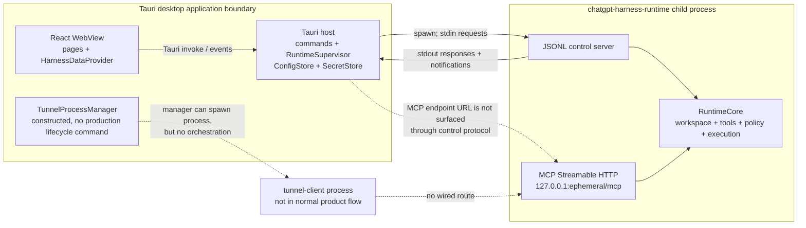

# CODEBASE MAP

> 基准：当前 `HEAD` 的源码、manifest、测试与构建脚本。归档历史文档（`docs/archive/**`）不作为当前实现事实来源；如果代码证据不足，应标记为 `Unclear`，而不是用历史文档补齐结论。

## 1. Repository Structure

| 区域 | 当前职责 | 主要边界 |
| --- | --- | --- |
| `protocol/` | UI/Tauri/Runtime 共用的 control protocol 模型；导出 JSON Schema 与 TypeScript 类型 | 定义 contract，不实现 Runtime transport 或业务逻辑 |
| `runtime/` | 独立 Rust child process；拥有 workspace、tools、policy、execution、activity/audit、diagnostics 与 MCP HTTP endpoint | stdin/stdout 上承载 control JSONL；loopback HTTP 上承载 MCP |
| `ui/src-tauri/` | 桌面 host；保存本机配置/secret，发现并监管 Runtime child process，把 Tauri command 转成 control RPC | Runtime 生命周期的生产 owner；Tunnel manager 已构造但未进入产品编排 |
| `ui/src/` | React WebView；页面、provider、real/mock client 与 Tauri `invoke`/event adapter | Tauri 环境使用 `TauriHarnessControlClient`；普通浏览器回退到 MockClient |
| `ui/scripts/` | Windows release staging、NSIS bundle 校验与开发端口准备 | 当前 staging/bundle 路径覆盖 UI + Runtime；Tunnel payload 未纳入 |
| `protocol/fixtures/`, `protocol/generated/` | wire fixtures、JSON Schema、生成的 TypeScript contract | generated artifacts 有同步测试；fixtures 只验证 model/schema 兼容，不是 Runtime 输出的 golden test |
| `tunnel-client-v0.0.13-windows-amd64/` | 仓库内已有 tunnel-client/cloudflared 二进制包 | 当前生产启动链不调用它，distribution staging 也未把它纳入安装产物 |
| `wiki/` | 当前 code-derived 项目地图与实现状态基线 | 应以源码为依据维护，不得从归档历史文档反推当前状态 |

Rust workspace 由根 `Cargo.toml` 声明的三个 member 组成：`protocol`、`runtime`、`ui/src-tauri`。前端是 `ui/package.json` 管理的独立 Vite/React 工程。

## 2. Process Architecture

当前真实运行边界：

- React WebView 与 Tauri Rust host 属于同一个桌面应用边界；React 通过 Tauri IPC/API 调用 Rust host。不要依赖“它们一定处于同一个 OS process”这一假设来理解架构。
- `RuntimeSupervisor` 启动独立 `chatgpt-harness-runtime` child process。
- MCP server 运行在 Runtime process 内的专用 OS thread + Tokio runtime 中，不是独立 process；它绑定 `127.0.0.1` 的随机端口。
- `TunnelProcessManager` 在 Tauri setup 中被实例化，但没有注册 start/stop/status lifecycle command，也没有被 `runtime_start` 调用；因此正常产品流程不会启动 tunnel-client process。

主要证据：

- `ui/src-tauri/src/lib.rs`
- `ui/src-tauri/src/runtime/mod.rs`
- `runtime/src/server.rs`
- `runtime/src/mcp/runtime.rs`
- `runtime/src/mcp/http.rs`
- `ui/src-tauri/src/tunnel/mod.rs`

## 3. Control Flow

### UI → Tauri → Runtime

1. React 页面调用 `HarnessDataProvider` 暴露的 action/read。
2. Provider 调用 `HarnessControlClient`；Tauri 环境选择 `TauriHarnessControlClient`，否则选择 MockClient。
3. Real client 用 `@tauri-apps/api/core.invoke(command, args)` 调用已注册 Tauri command。
4. Tauri command 调用单例 `RuntimeSupervisor`。
5. Supervisor 为 RPC 生成 request id，把一行 JSON 写入 child stdin，并把 response channel 放入 pending map。
6. Runtime 从 stdin 逐行反序列化 `RpcMessage`、dispatch，再把 response/error 写到 stdout。
7. Tauri stdout reader 按 response id 完成 pending request；`activity.event` notification 则转发为 `runtime:activity` Tauri event。

主要证据：

- `ui/src/services/harness/local-client.ts`
- `ui/src-tauri/src/runtime/mod.rs`
- `runtime/src/server.rs`
- `protocol/src/rpc.rs`

### Initialize handshake

`runtime_start`
→ 加载并校验 AppConfig
→ Runtime discovery
→ spawn child
→ `initialize` request（protocol version + workspace/security/limits snapshot）
→ Runtime 构造 WorkspaceGuard、ExecutionPipeline 与 activity/event stores
→ Runtime 启动 MCP loopback endpoint
→ 返回 `InitializeResult`
→ Tauri 校验 protocol/runtime version
→ 发送 `initialized` notification
→ Runtime acknowledge 后进入 Ready
→ Tauri 请求 `runtime.status`。

如果 MCP endpoint 启动失败，Runtime initialize 会失败；如果 child 初始化失败，Supervisor 会终止本次 child。

主要证据：

- `ui/src-tauri/src/runtime/mod.rs`
- `runtime/src/server.rs`
- `runtime/src/state.rs`

### Notifications are not one unified activity stream

当前有两套不同用途的 activity 路径：

- `activity.list` / `activity.subscribe` 读取 lifecycle `EventBus`。生产写入目前主要是 Runtime started/stopped 一类 lifecycle event；订阅后通过 stdout notification → Tauri event 转发。
- MCP/tool execution audit 进入独立 `ActivityStore`，通过 `control.activity.snapshot` 读取；当前 `ActivityPage` 使用的是这条 snapshot 链，不是 live lifecycle subscription。
- `useActivitySubscription` 当前没有挂入生产组件树。

因此不要把 `activity.event` subscription 与 tool execution audit 当成同一条实时事件流。

主要证据：

- `runtime/src/events.rs`
- `runtime/src/activity/mod.rs`
- `runtime/src/control_read.rs`
- `ui/src/pages/activity/ActivityPage.tsx`

## 4. Subsystem Map

| Subsystem | Responsibility | Main entry points | Called by | Calls into | Current integration level |
| --- | --- | --- | --- | --- | --- |
| Protocol | Control JSONL DTO、方法名、错误、config/runtime/tool/policy/activity/approval/diagnostics/control-read contract | `protocol/src/rpc.rs`, `protocol/src/v1/**` | Runtime、Tauri、generated TS | serde/schema/TS export | **Implemented**；generated schema/types 有同步测试；fixtures 不是 Runtime golden test，存在已确认 drift |
| UI | 页面、状态装载、生命周期操作、只读 observability | `ui/src/App.tsx`, `ui/src/pages/**`, `HarnessDataProvider.tsx` | 用户/WebView | HarnessControlClient | **Implemented**，但部分 client 能力没有生产 UI 消费者 |
| Tauri Host | command registry、本地持久化、Runtime supervision、event bridge | `ui/src-tauri/src/lib.rs`, `commands/**`, `runtime/**` | React invoke | Config/Secrets/Runtime child | Runtime 链 **Implemented**；Tunnel orchestration 未接入 |
| Runtime Core | 初始化状态与 subsystem ownership | `runtime/src/main.rs`, `server.rs`, `state.rs` | Runtime process control loop | workspace/tools/policy/execution/MCP | **Implemented** |
| Workspace | workspace root canonicalization 与安全 guard | `runtime/src/workspace/**` | RuntimeCore、ExecutionPipeline | filesystem | **Implemented**；Windows 特殊路径、逃逸、symlink/junction 有测试；仍有 TOCTOU 不确定性 |
| Tools | `read_file`、`glob`、registry 与 effective catalog | `runtime/src/tools/**` | RuntimeCore、ExecutionPipeline、MCP | WorkspaceGuard | 两个 read-only tool **Implemented** |
| Policy | 固定 system rule snapshot 与 fail-closed evaluation | `runtime/src/policy/engine.rs` | ExecutionPipeline、effective catalog | ToolRegistry | evaluation **Implemented**；`policies.list` 的可视化投影仍是空列表 |
| Execution | readiness → argument → workspace → policy → executor 状态机 | `runtime/src/execution/pipeline.rs` | MCP adapters、Runtime typed internal calls | guard/policy/tools/audit | Runtime 内执行链 **Implemented**；外部 MCP 产品链尚未闭合 |
| Approvals | ASK 结果与 protocol DTO | pipeline ASK branch；`approvals.*` dispatch | Policy/Control RPC | 无 pending store/resume | **Stub / Placeholder**；只能返回 ApprovalRequired，不能完成批准后恢复执行 |
| Activity | lifecycle EventBus；execution ActivityStore | `events.rs`, `activity/mod.rs` | Runtime lifecycle；AuditSink | RPC list/subscription；control snapshot | 两条独立路径均有实现，但不是统一 live feed |
| Audit | 每次 execution 的结构化/redacted 事件 | `audit/**`, `ExecutionPipeline::emit` | ExecutionPipeline | ActivityStore | **Implemented / Internal**；内存、非 durable audit log |
| Diagnostics | Runtime safe snapshot、local setup checks、旧 `diagnostics.run` | `runtime/src/diagnostics/**`, `commands::local_diagnostics_run` | control-read / UI overview | Runtime state/config/platform | control-read 路径 **Implemented**；`diagnostics.run` 是固定 skeleton response |
| Config | AppConfig schema、revision、atomic JSON save/reset | `protocol/src/v1/config.rs`, `ui/src-tauri/src/config/mod.rs` | Settings / runtime_start | OS app data `config.json` | **Implemented** |
| Secrets | API key reference 与 secret store | `ui/src-tauri/src/secrets/mod.rs` | config commands | Windows Credential Manager（Windows） | 存取 **Implemented**；未被 Tunnel launch 消费 |
| MCP | rmcp ServerHandler、read adapters、loopback Streamable HTTP lifecycle | `runtime/src/mcp/**`, `server.rs` | Runtime initialize | effective tools/execution pipeline | **Partially Integrated**：Runtime 内 HTTP E2E 可用；endpoint URL 未向 Tauri/Tunnel/UI 暴露 |
| Tunnel | child lifecycle manager | `ui/src-tauri/src/tunnel/mod.rs` | tests；Tauri 只构造 manager | external executable | manager **Implemented / Internal**；产品编排 **Not Implemented** |
| Distribution | release build、staging、manifest validation、NSIS resources | `ui/scripts/**`, runtime discovery/manifest, `tauri.conf.json` | npm/Tauri build scripts | Cargo/Tauri/NSIS | **Partially Integrated**：UI+Runtime staging/bundle 路径存在；未验证真实安装 E2E，Tunnel payload 未打包 |

## 5. Important Call Chains

### 5.1 Runtime start — reaches Ready

`OverviewPage Start Harness`
→ `HarnessDataProvider.startHarness`
→ `TauriHarnessControlClient.runtimeStart`
→ Tauri `runtime_start`
→ config load/validation
→ `RuntimeSupervisor.start`
→ runtime discovery
→ child spawn
→ `initialize`
→ `RuntimeCore.initialize`
→ `McpRuntimeService.start`
→ `initialized`
→ Runtime acknowledge
→ `runtime.status`
→ UI resource refresh。

### 5.2 Runtime stop — graceful then forced fallback

`OverviewPage Stop Harness`
→ provider
→ local client
→ Tauri `runtime_stop`
→ Supervisor marks Stopping
→ `runtime.stop` RPC
→ Runtime disables readiness / emits stop lifecycle event
→ MCP shutdown/join
→ control loop exits
→ Supervisor waiter observes exit。

如果 graceful stop 超时或失败，Supervisor 会进入 kill + wait fallback。

### 5.3 Tools — two different reads

- Legacy catalog：Provider startup → `toolsList` → `runtime_tools_list` → `tools.list` → `ToolRegistry.list`。Provider 会加载，但当前 `ToolsPage` 不以它作为主要展示源。
- Visible effective tools：`ToolsPage` → `runtimeGetEffectiveTools` → `runtime_get_effective_tools` → `control.effective_tools.get` → `RuntimeCore.effective_tools` → policy/readiness-derived catalog。

当前 Tools 页面真正展示的是第二条链。

### 5.4 Activity / observability — manual execution snapshot

`ActivityPage`
→ `useControlRead`
→ `runtimeGetActivitySnapshot(100)`
→ Tauri `runtime_get_activity_snapshot`
→ control RPC `control.activity.snapshot`
→ Runtime `ActivityStore.snapshot`。

MCP request 的 pipeline audit 会写入该 store，因此能显示实际 tool execution；它是手工 snapshot，不是 live subscription。

### 5.5 Config save/load — does not enter Runtime until restart

`SettingsPage`
→ provider `saveConfig/refreshConfig`
→ local client `config_save/config_get`
→ Tauri ConfigStore
→ validation
→ optional secret write
→ atomic file replace
→ revision update。

已经运行的 Runtime 持有 initialize 时的 immutable config snapshot；新配置需要 restart 才进入 Runtime。

### 5.6 Diagnostics — visible path is real, legacy command is placeholder

当前 Overview 可见路径：

`RuntimeOverview`
→ `runtimeGetDiagnostics`
→ Tauri `runtime_get_diagnostics`
→ `control.diagnostics.get`
→ `RuntimeCore.diagnostics`
→ safe snapshot。

相对地，`diagnostics.run` 仍返回固定 `runtime_skeleton` PASS check，不应视为真实诊断流程。

### 5.7 MCP tool call — local HTTP works, external product chain breaks after bind

Runtime initialize
→ `McpRuntimeService.start`
→ bind `127.0.0.1:0/mcp`
→ rmcp `McpService.list_tools/call_tool`
→ read_file/glob adapter
→ shared `McpExecutionContext`
→ ExecutionPipeline
→ WorkspaceGuard
→ PolicyEngine
→ executor
→ audit/activity。

链路在“让外部 caller 获得 endpoint URL”处断开：URL 只保存在 process-local `McpRuntimeService.endpoint_url`，没有进入 `InitializeResult`、RuntimeState、Tauri command 或 React client；Tunnel 也未进入生产启动链。

因此只能确认 Runtime 内 local HTTP transport E2E，不能确认 ChatGPT/Tunnel E2E。

## 6. Source-of-Truth Locations

| 想确认的事实 | 首选源码 |
| --- | --- |
| Control wire envelope / errors | `protocol/src/rpc.rs` |
| v1 method registry / lifecycle DTO | `protocol/src/v1/methods.rs`, `initialize.rs`, `runtime.rs` |
| Config、tool、policy、activity、approval、diagnostics contract | `protocol/src/v1/**` |
| Runtime control dispatch | `runtime/src/server.rs` |
| Runtime-owned state 与构造顺序 | `runtime/src/state.rs` |
| Workspace/path security | `runtime/src/workspace/**` |
| Declared/effective tools | `runtime/src/tools/registry.rs`, `effective.rs` |
| Policy decision | `runtime/src/policy/engine.rs` |
| Tool execution order | `runtime/src/execution/pipeline.rs` |
| MCP exposure / transport | `runtime/src/mcp/service.rs`, `runtime.rs`, `http.rs` |
| Audit 与 UI activity projection | `runtime/src/audit/**`, `runtime/src/activity/mod.rs` |
| Lifecycle activity notification | `runtime/src/events.rs`, `runtime/src/server.rs` |
| Tauri command surface | `ui/src-tauri/src/lib.rs` |
| Runtime child supervision / RPC correlation | `ui/src-tauri/src/runtime/mod.rs` |
| Runtime binary discovery / manifest | `ui/src-tauri/src/runtime/discovery.rs`, `manifest.rs` |
| Local config / secret storage | `ui/src-tauri/src/config/mod.rs`, `secrets/mod.rs`, `commands/mod.rs` |
| Tunnel lifecycle implementation | `ui/src-tauri/src/tunnel/mod.rs` |
| React 页面真实入口 | `ui/src/App.tsx`, `ui/src/pages/**` |
| UI-to-Tauri mapping | `ui/src/services/harness/local-client.ts` |
| UI orchestration/state | `ui/src/app/providers/HarnessDataProvider.tsx` |
| Windows distribution | `ui/package.json`, `ui/scripts/**`, `ui/src-tauri/tauri.conf.json` |
| 测试所证明的层级 | 对应模块内 `#[cfg(test)]`、`protocol/tests/contracts.rs`、`ui/src/**/*.test.*` |

归档历史文档（`docs/archive/**`）不是当前实现 source of truth。

## 7. Known Protocol / Fixture Drift

当前源码中存在至少两项明确的 fixture ↔ Runtime output 漂移：

1. `protocol/fixtures/v1/rpc.error.not_initialized.json` 使用 numeric code `-32001`；Runtime 当前 `NOT_INITIALIZED_ERROR` 使用 `error_codes::HARNESS_MIN`，而 `-32001` 被用于 `ALREADY_INITIALIZED_ERROR`。
2. `protocol/fixtures/v1/initialize.response.json` 使用 server name `harness-runtime` 并声明 `activityReplay`；Runtime 当前返回 `chatgpt-harness-runtime`，capabilities 为 default empty。

`protocol/tests/contracts.rs` 会验证 fixture 可以按 schema/model 解析，并验证 generated artifacts 与源码同步；它**不会**启动 Runtime 并把真实 Runtime 输出与这些 fixtures 做 golden equality 断言。

因此：

> “Protocol contract tests 通过”只能证明 fixture/model/schema 兼容与 generated artifacts 同步，不能证明 fixture 与 Runtime 实际 wire output 完全一致。

## 8. Test Reality

生成这份 archaeology 基线的上一轮验证记录为：

- `cargo test --workspace`：205 passed（Runtime 154、Tauri host 42、Protocol contract 9）。
- `npm test`：77 passed（jsdom / mocked Tauri API）。
- `npm run build`：TypeScript checks 与 Vite production build passed。

这些结果应按测试层级解释：

- Runtime tests 能证明 stdio dispatch、MCP loopback、workspace security、execution/policy/activity 等局部或进程内路径。
- Tauri supervisor tests 使用 fixture child process，不等于真实 packaged Runtime / installed layout E2E。
- UI tests 主要证明 component/provider/client contract；mocked Tauri API 不会启动真实 Tauri/Runtime。
- 未发现自动化测试从打包后的 React UI 启动真实 Runtime，再经 Tunnel/ChatGPT 调用 MCP。

因此测试通过不能升级为“产品级 external connection E2E 已完成”。

## 9. Current High-Risk Interpretation Traps

后续 Wiki 与开发任务中应特别避免以下误判：

- `TunnelProcessManager` 存在 ≠ Tunnel 产品链已接通。
- Runtime 内 MCP endpoint Ready ≠ ChatGPT/Tunnel 已能连接。
- UI 显示 MCP ready ≈ Runtime readiness projection，不是 external reachability proof。
- `policies.list` 返回空 ≠ PolicyEngine 没有生效规则。
- Approval DTO/command 存在 ≠ approval resume workflow 已实现。
- Protocol fixtures 通过 schema test ≠ Runtime 实际 output 与 fixtures 一致。
- MockClient 能演示某状态 ≠ real adapter 已实现同等能力。
