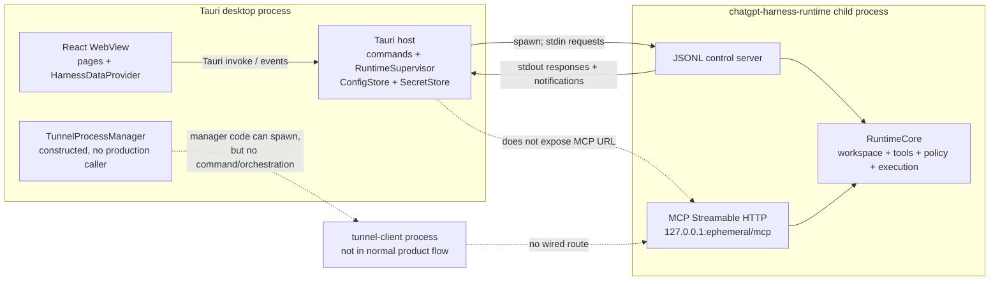

# CODEBASE MAP

> 基准：当前 `HEAD` 的源码、manifest、测试与构建脚本。本文不以 README、`docs/**`、Roadmap 或历史 spec 作为当前事实来源。工作树中原有未提交修改不属于本次调查结论。

## 1. Repository Structure

| 区域 | 当前职责 | 主要边界 |
| --- | --- | --- |
| `protocol/` | UI/Tauri/Runtime 共用的 control protocol（控制协议）模型；导出 JSON Schema 与 TypeScript 类型 | 只定义 contract，不实现 transport 或业务 |
| `runtime/` | 独立 Rust child process；拥有 workspace、tool、policy、execution、activity/audit、diagnostics 与 MCP HTTP endpoint | stdin/stdout 上承载 control JSONL；loopback HTTP 上承载 MCP |
| `ui/src-tauri/` | 桌面 host；保存本机配置/secret，发现并监管 Runtime child process，把 Tauri command 转成 control RPC | Runtime 生命周期的唯一生产 owner；Tunnel manager 虽被构造但未编排 |
| `ui/src/` | React WebView；页面、provider、real/mock client 与 Tauri `invoke`/event adapter | 生产环境使用 `TauriHarnessControlClient`；普通浏览器回退到 MockClient |
| `ui/scripts/` | Windows release staging、NSIS bundle 校验与开发端口准备 | `HEAD` 的 staging 产物只包含 UI、Runtime 与 distribution manifest |
| `protocol/fixtures/`, `protocol/generated/` | wire fixtures、JSON Schema、生成的 TypeScript contract | 由 protocol contract tests 校验同步性 |
| `tunnel-client-v0.0.13-windows-amd64/` | 仓库内已有 tunnel-client/cloudflared 二进制包 | 当前 `HEAD` 分发脚本不把它纳入安装产物，正常启动链也不调用它 |

Rust workspace 由根 `Cargo.toml` 声明的三个 member 组成：`protocol`、`runtime`、`ui/src-tauri`。前端是 `ui/package.json` 管理的独立 Vite/React 工程。

## 2. Process Architecture

当前真实运行边界：

- React WebView 与 Tauri Rust host 同属桌面应用，但通过 Tauri IPC（进程内 host bridge）交互。
- `RuntimeSupervisor` 启动独立 `chatgpt-harness-runtime` child process。
- MCP server 是 Runtime 内的专用 OS thread + Tokio runtime，不是独立 process；它绑定 `127.0.0.1` 的随机端口。
- `TunnelProcessManager` 在 Tauri setup 中被实例化，但没有注册 start/stop/status command，也没有被 `runtime_start` 调用；因此正常产品流程不会出现 tunnel-client process。

证据：`ui/src-tauri/src/lib.rs:15-49`、`ui/src-tauri/src/runtime/mod.rs:239-357`、`runtime/src/server.rs:23-97`、`runtime/src/mcp/runtime.rs:75-167`、`runtime/src/mcp/http.rs:105-141`、`ui/src-tauri/src/tunnel/mod.rs:114-368`。

## 3. Control Flow

### UI → Tauri → Runtime

1. React 页面调用 `HarnessDataProvider` 暴露的 action/read。
2. Provider 调用 `HarnessControlClient`；Tauri 环境选择 `TauriHarnessControlClient`，否则选择 MockClient。
3. Real client 用 `@tauri-apps/api/core.invoke(command, args)` 调用已注册 command。
4. Tauri command 调用单例 `RuntimeSupervisor`。
5. Supervisor 为每次 RPC 生成 `tauri-<uuid>` string request id，把一行 UTF-8 JSON 加换行写入 child stdin，并把 response channel 放入 pending map。
6. Runtime 从 stdin 逐行反序列化 `RpcMessage`、dispatch，再把 response/error 写到 stdout。
7. Tauri stdout reader 按 response id 完成 pending request；`activity.event` notification 则转发为 `runtime:activity` Tauri event。

证据：`ui/src/services/harness/local-client.ts:76-235`、`ui/src-tauri/src/runtime/mod.rs:651-750`、`ui/src-tauri/src/runtime/mod.rs:931-970`、`runtime/src/server.rs:29-119`、`protocol/src/rpc.rs:6-78`。

### Initialize handshake

`runtime_start` 加载并校验 AppConfig → Runtime discovery → spawn child → `initialize` request（含 protocol version、workspace/security/limits snapshot）→ Runtime 构造 WorkspaceGuard、ExecutionPipeline 与 activity/event stores → Runtime 启动 MCP loopback endpoint → 返回 `InitializeResult` → Tauri 校验 protocol/runtime version → 发送 `initialized` notification → Runtime 把 phase 与 MCP readiness 置为 Ready → Tauri 请求 `runtime.status`。

若 MCP endpoint 启动失败，Runtime 回滚本次 core initialization；若 child 初始化失败，Supervisor 终止该 child。证据：`ui/src-tauri/src/runtime/mod.rs:329-355,508-552`、`runtime/src/server.rs:190-251,397-415`、`runtime/src/state.rs:62-99,172-184`。

### Notifications are not one unified activity stream

- `activity.list` / `activity.subscribe` 读取 `EventBus`，目前生产写入者是 Runtime lifecycle 的 start/stop publish；订阅后由 stdout notification → Tauri event 转发。
- MCP/tool execution audit 进入另一个 `ActivityStore`，通过 `control.activity.snapshot` 手动读取；当前 ActivityPage 使用的是这条 snapshot 链，而不是 live subscription。
- `useActivitySubscription` 目前只在测试中使用，未挂入生产组件树。

证据：`runtime/src/events.rs:5-64`、`runtime/src/state.rs:172-215`、`runtime/src/activity/mod.rs:82-120`、`runtime/src/control_read.rs:43-53`、`ui/src/pages/activity/ActivityPage.tsx:7-27`。

## 4. Subsystem Map

| Subsystem | Responsibility | Main entry points | Called by | Calls into | Current integration level |
| --- | --- | --- | --- | --- | --- |
| Protocol | Control JSONL DTO、方法名、错误、config/runtime/tool/policy/activity/approval/diagnostics/control-read contract | `protocol/src/rpc.rs`, `protocol/src/v1/**` | Runtime、Tauri、generated TS | serde/schema/TS export | **Implemented**；v1，contract tests 固定 wire shape |
| UI | 页面、状态装载、生命周期操作、只读 observability | `ui/src/App.tsx`, `ui/src/pages/**`, `HarnessDataProvider.tsx` | 用户/WebView | HarnessControlClient | **Implemented**，但部分 client 能力没有生产 UI 消费者 |
| Tauri Host | command registry、本地持久化、Runtime supervision、event bridge | `ui/src-tauri/src/lib.rs`, `commands/**`, `runtime/**` | React invoke | Config/Secrets/Runtime child | Runtime 链 **Implemented**；Tunnel orchestration 未接入 |
| Runtime Core | 初始化状态与 subsystem ownership | `runtime/src/main.rs`, `server.rs`, `state.rs` | Runtime process control loop | workspace/tools/policy/execution/MCP | **Implemented** |
| Workspace | workspace root canonicalization 与安全 guard | `runtime/src/workspace/workspace.rs`, `guard.rs`, `path_resolver.rs` | RuntimeCore、ExecutionPipeline | filesystem canonicalization | **Implemented**；Windows 特殊路径、逃逸、symlink/junction 有测试 |
| Tools | `read_file`、`glob`、registry 与 effective catalog | `runtime/src/tools/**` | RuntimeCore、ExecutionPipeline、MCP | WorkspaceGuard | 两个 read-only tool **Implemented** |
| Policy | 固定 system rule snapshot 与 fail-closed evaluation | `runtime/src/policy/engine.rs` | ExecutionPipeline、effective catalog | ToolRegistry | 执行链 **Implemented**；`policies.list` 对外仍返回空 |
| Execution | readiness → argument → workspace → policy → executor 状态机 | `runtime/src/execution/pipeline.rs` | MCP adapters、Runtime typed internal calls | guard/policy/tools/audit | MCP 路径 **Implemented** |
| Approvals | ASK 结果与 protocol DTO | pipeline ASK branch；`approvals.*` dispatch | Policy/Control RPC | 无 pending store/resume | **Stub / Placeholder**；只能报告 ApprovalRequired，不能审批后续跑 |
| Activity | lifecycle EventBus；execution ActivityStore | `events.rs`, `activity/mod.rs` | Runtime lifecycle；AuditSink | RPC list/subscription；control snapshot | 两条独立路径均有实现，但不是统一 live feed |
| Audit | 每次 execution 的安全、删减事件 | `audit/**`, `ExecutionPipeline::emit` | ExecutionPipeline | ActivityStore | **Implemented / Internal**；内存、非 durable audit log |
| Diagnostics | 安全 Runtime snapshot、local setup checks、旧 diagnostics.run | `runtime/src/diagnostics/**`, `commands::local_diagnostics_run` | control-read / UI overview | Runtime state/config/platform | control-read 路径 **Implemented**；`diagnostics.run` 是固定 skeleton response |
| Config | AppConfig schema、revision、atomic JSON save/reset | `protocol/src/v1/config.rs`, `ui/src-tauri/src/config/mod.rs` | Settings / runtime_start | OS app data `config.json` | **Implemented** |
| Secrets | API key reference 与 secret store | `ui/src-tauri/src/secrets/mod.rs` | config commands | Windows Credential Manager（Windows） | 存取 **Implemented**；未被 Tunnel launch 消费 |
| MCP | rmcp ServerHandler、read adapters、loopback Streamable HTTP lifecycle | `runtime/src/mcp/**`, `server.rs` | Runtime initialize | effective tools/execution pipeline | **Partially Integrated**：Runtime 内 HTTP E2E 可用；endpoint URL 未向 Tauri/Tunnel/UI 暴露 |
| Tunnel | child lifecycle manager | `ui/src-tauri/src/tunnel/mod.rs` | 仅 tests；Tauri 只构造 manager | external executable | **Implemented / Internal** manager；产品编排 **Not Implemented** |
| Distribution | release build、staging、manifest validation、NSIS resources | `ui/scripts/**`, `runtime/discovery.rs`, `runtime/manifest.rs`, `tauri.conf.json` | npm build scripts / RuntimeSupervisor | Cargo/Tauri/NSIS | UI+Runtime installer path **Implemented**；Tunnel payload 未打包 |

## 5. Important Call Chains

### 5.1 Runtime start — reaches Ready

`OverviewPage Start Harness` → `HarnessDataProvider.startHarness` → `TauriHarnessControlClient.runtimeStart` → Tauri `runtime_start` → config load/validation → `RuntimeSupervisor.start` → runtime discovery → child spawn → `initialize` request → `RuntimeCore.initialize` → `McpRuntimeService.start` → `initialized` notification → `RuntimeCore.acknowledge` → `runtime.status` → UI resource refresh。

Evidence: `ui/src/pages/overview/OverviewPage.tsx:6-31`、`HarnessDataProvider.tsx:344-364`、`local-client.ts:146-155`、`commands/mod.rs:215-225`、`runtime/mod.rs:239-357,508-552`、`runtime/src/server.rs:190-251`。

### 5.2 Runtime stop — graceful then forced fallback

`OverviewPage Stop Harness` → provider → local client → Tauri `runtime_stop` → Supervisor marks Stopping → `runtime.stop` RPC → Runtime disables readiness/publishes stop event → MCP shutdown/join → response then control loop exits → Supervisor waiter observes exit。若超时或 RPC 失败，Supervisor kill + wait。

Evidence: `HarnessDataProvider.tsx:366-386`、`local-client.ts:167-173`、`commands/mod.rs:298-303`、`runtime/mod.rs:368-430`、`runtime/src/server.rs:261-282`。

### 5.3 Tools — two different reads

- Legacy catalog: Provider startup → `toolsList` → `runtime_tools_list` → `tools.list` → `ToolRegistry.list`. 数据被 provider 保存，但当前 ToolsPage 不使用它。
- Visible effective tools: ToolsPage → `runtimeGetEffectiveTools` → `runtime_get_effective_tools` → `control.effective_tools.get` → `RuntimeCore.effective_tools` → policy/readiness-derived catalog。

第二条才是当前页面真实展示链，且完整走到 Runtime。Evidence: `HarnessDataProvider.tsx:263-277`、`ToolsPage.tsx:7-24`、`local-client.ts:129-140,219-225`、`commands/control_read.rs:35-40`、`runtime/src/control_read.rs:48-53`。

### 5.4 Activity / observability — manual execution snapshot

`ActivityPage` → `useControlRead` → `runtimeGetActivitySnapshot(100)` → Tauri `runtime_get_activity_snapshot` → control RPC `control.activity.snapshot` → Runtime `ActivityStore.snapshot`。MCP request 的 pipeline audit 会写入该 store，因此本链能显示实际 tool execution；它是手动 snapshot，不是 live stream。

Evidence: `ActivityPage.tsx:7-27`、`commands/control_read.rs:25-33`、`runtime/src/control_read.rs:43-47`、`activity/mod.rs:95-120`。

### 5.5 Config save/load — does not enter Runtime until restart

`SettingsPage` → provider `saveConfig/refreshConfig` → local client `config_save/config_get` → Tauri ConfigStore → validate existing file and new config → optional secret write → atomic `config.json.tmp` replace → revision update。正在运行的 Runtime 持有 initialize 时的 immutable snapshot；UI 通过 revision mismatch 提示 restart。

Evidence: `SettingsPage.tsx:58-74`、`HarnessDataProvider.tsx:193-213,283-299`、`commands/mod.rs:45-107`、`config/mod.rs:56-151`。

### 5.6 Diagnostics — visible path is real, legacy command is placeholder

`RuntimeOverview` → `runtimeGetDiagnostics` → Tauri `runtime_get_diagnostics` → `control.diagnostics.get` → `RuntimeCore.diagnostics` → safe snapshot。相对地，`runtime_diagnostics_run` → `diagnostics.run` 返回固定 `runtime_skeleton` pass check，且当前生产 UI 的 `runDiagnostics` 只调用 Tauri local checks，也没有页面调用者。

Evidence: `RuntimeOverview.tsx:7-24`、`commands/control_read.rs:18-23`、`runtime/src/control_read.rs:43-45`、`runtime/src/server.rs:360-381`、`HarnessDataProvider.tsx:393-397`。

### 5.7 MCP tool call — local HTTP works, external product chain breaks after bind

Runtime initialize → `McpRuntimeService.start` → `start_mcp_http_endpoint` binds `127.0.0.1:0/mcp` → rmcp `McpService.list_tools/call_tool` → read_file/glob adapter → shared `McpExecutionContext` → ExecutionPipeline → WorkspaceGuard → PolicyEngine → executor → audit/activity。

链路在“让外部 caller 获得 endpoint URL”处断开：URL 只保存在 process-local `McpRuntimeService.endpoint_url`，不在 `InitializeResult`/RuntimeState/Tauri command 中；Tunnel 也未启动。因此只能确认 Runtime 内 local HTTP transport E2E，不能确认 ChatGPT/Tunnel E2E。

Evidence: `runtime/src/mcp/runtime.rs:75-167`、`mcp/http.rs:105-141`、`mcp/service.rs:27-96`、`mcp/context.rs`、`server.rs:226-250`。

## 6. Source-of-Truth Locations

| 想确认的事实 | 首选源码 |
| --- | --- |
| Control wire envelope / errors | `protocol/src/rpc.rs` |
| v1 method registry / lifecycle DTO | `protocol/src/v1/methods.rs`, `initialize.rs`, `runtime.rs` |
| Config、tool、policy、activity、approval、diagnostics contract | `protocol/src/v1/**` |
| Runtime control dispatch | `runtime/src/server.rs` |
| Runtime-owned state与构造顺序 | `runtime/src/state.rs` |
| Workspace/path security | `runtime/src/workspace/**` |
| Declared/effective tools | `runtime/src/tools/registry.rs`, `effective.rs` |
| Policy decision | `runtime/src/policy/engine.rs` |
| Tool execution order | `runtime/src/execution/pipeline.rs` |
| MCP exposure / transport | `runtime/src/mcp/service.rs`, `runtime.rs`, `http.rs` |
| Audit 与 UI activity projection | `runtime/src/audit/**`, `runtime/src/activity/mod.rs` |
| Lifecycle activity notification | `runtime/src/events.rs`, `runtime/src/server.rs` |
| Tauri command surface | `ui/src-tauri/src/lib.rs` |
| Runtime child supervision / RPC correlation | `ui/src-tauri/src/runtime/mod.rs` |
| Runtime binary discovery / manifest | `ui/src-tauri/src/runtime/discovery.rs`, `manifest.rs` |
| Local config / secret storage | `ui/src-tauri/src/config/mod.rs`, `secrets/mod.rs`, `commands/mod.rs` |
| Tunnel lifecycle implementation与实际 callers | `ui/src-tauri/src/tunnel/mod.rs`，再用 `rg TunnelProcessManager` 验证 caller |
| React 页面真实入口 | `ui/src/App.tsx`, `ui/src/pages/**` |
| UI-to-Tauri mapping | `ui/src/services/harness/local-client.ts` |
| UI orchestration/state | `ui/src/app/providers/HarnessDataProvider.tsx` |
| Windows distribution | `ui/package.json`, `ui/scripts/**`, `ui/src-tauri/tauri.conf.json` |
| 测试所证明的层级 | 对应模块内 `#[cfg(test)]`、`protocol/tests/contracts.rs`、`ui/src/**/*.test.*` |

## 7. Test Reality

- `cargo test --workspace`：205 passed（Runtime 154、Tauri host 42、Protocol contract 9）。其中 Runtime tests 覆盖真实 stdio dispatch、MCP HTTP loopback、workspace security、execution/policy/activity；Tauri tests 以 fixture child process 验证 supervisor，不是打包后桌面 UI E2E。
- `npm test`：77 passed。主要是 component/provider/client contract 与 MockClient；`local-client.test.ts` mock 掉 Tauri API，不会启动真实 Tauri/Runtime。
- `npm run build`：TypeScript checks 与 Vite production build 通过。
- 未发现自动化测试从打包后的 React UI 启动真实 Runtime，再从外部 tunnel/ChatGPT 调 MCP。因此这些测试不能证明产品级 external connection E2E。
